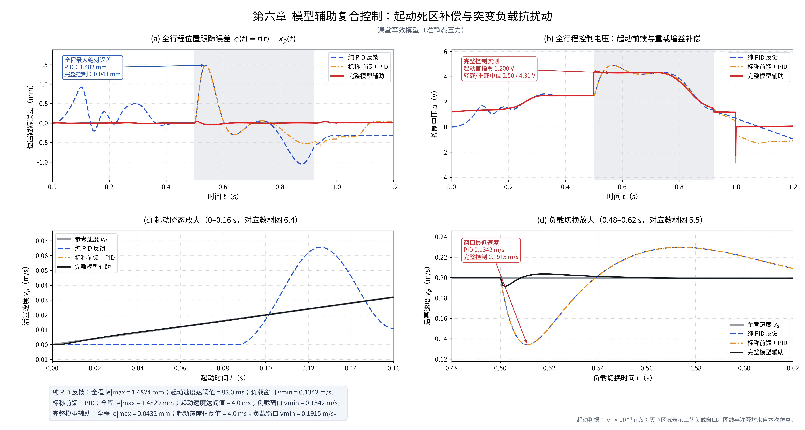
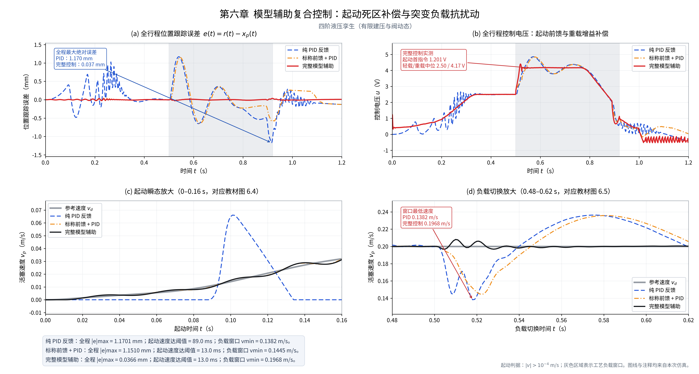

# 第六章课堂编程实验报告

本报告由 `build_report.py` 读取随包保存的原始指标自动生成；公式、参数及适用条件见 README。

## 课堂模型（准静态负载压力，参考图 a）

| 实测指标 | 纯 PID | 标称前馈 + PID | 完整模型辅助 |
|---|---:|---:|---:|
| 全程最大绝对误差/mm | 1.482432 | 1.482874 | 0.043200 |
| 全程误差RMSE/mm | 0.480646 | 0.358116 | 0.012436 |
| 首控制电压/V | 0.000000 | 1.200000 | 1.200000 |
| 首个非零前馈电压/V | — | 1.200000 | 1.200000 |
| 首次静摩擦释放/ms | 86.962 | 2.987 | 2.986 |
| 速度达阈值时刻/ms | 88.000 | 4.000 | 4.000 |
| 起动速度超调/(m/s) | 0.040520 | 0.000355 | 0.000376 |
| 负载窗口最低速度/(m/s) | 0.134186 | 0.134161 | 0.191453 |
| 负载速度跌落/% | 32.907 | 32.920 | 4.274 |
| 负载窗口最大绝对误差/mm | 1.482432 | 1.482874 | 0.043200 |
| 轻载电压中位/V | 2.500964 | 2.500242 | 2.500180 |
| 重载电压中位/V | 4.852282 | 4.852446 | 4.311557 |
| 重载 P1 中位/MPa | 17.049667 | 17.049669 | 17.049006 |
| 流量增益下降/% | 49.688 | 49.688 | 49.688 |
| 峰值绝对电压/V | 4.9135 | 4.9136 | 4.4533 |

完整组全程最大误差 **0.043200 mm**，0.05 mm 验收：**通过**。

该对象使用用户给定的质量 500 kg、最大静摩擦 3100 N、层流泄漏系数 2.703e-09 m³/(s·Pa) 与阀时间常数 0.8 ms。阀动态、真实粘滑与液压等效阻抗参与闭环积分；工艺负载下的 P1 为代数工作点加运动力压降，不含双腔独立压力储能。

图 (a) 的最大误差由 PID 1.4824 mm、标称前馈 1.4829 mm 降为完整控制 0.0432 mm。PID 起动阈值时刻 88 ms；完整组首指令 1.200 V，首次静摩擦释放 2.986 ms，速度达阈值 4 ms。

给定重载代数工作点 P1=16.95 MPa，六步公式在 0.20 m/s 匀速时反演重载前馈 4.327 V；闭环重载窗口实测总电压中位数 4.312 V。前者取固定工作点，后者包含运动引起的压力和 PID 修正。

## 四阶双腔液压数字孪生（物理对照）

| 实测指标 | 纯 PID | 标称前馈 + PID | 完整模型辅助 |
|---|---:|---:|---:|
| 全程最大绝对误差/mm | 1.170126 | 1.150980 | 0.036622 |
| 全程误差RMSE/mm | 0.381893 | 0.285552 | 0.009075 |
| 首控制电压/V | 0.000000 | 1.225702 | 1.200705 |
| 首个非零前馈电压/V | — | 1.225702 | 1.200705 |
| 首次静摩擦释放/ms | 87.951 | 10.571 | 10.767 |
| 速度达阈值时刻/ms | 89.000 | 13.000 | 13.000 |
| 起动速度超调/(m/s) | 0.051672 | 0.002114 | 0.002252 |
| 负载窗口最低速度/(m/s) | 0.138177 | 0.144507 | 0.196840 |
| 负载速度跌落/% | 30.912 | 27.747 | 1.580 |
| 负载窗口最大绝对误差/mm | 1.169461 | 1.150980 | 0.028741 |
| 轻载电压中位/V | 2.497320 | 2.497912 | 2.498126 |
| 重载电压中位/V | 4.504323 | 4.606135 | 4.170078 |
| 重载 P1 中位/MPa | 15.154134 | 15.159225 | 15.187182 |
| 流量增益下降/% | 43.706 | 43.733 | 43.867 |
| 峰值绝对电压/V | 4.8529 | 4.8453 | 4.3978 |

完整组全程最大误差 **0.036622 mm**，0.05 mm 验收：**通过**。

四阶对照采用已知 142.0 kN 工艺负载、25 ms 加载和 30 ms 卸载；压力连续积分。首个非零前馈避免 PID 的误差蓄能等待，实际运动仍受建压与阀动态限制。

## 结果解释

纯 PID 等待误差积累后才跨过死区与静摩擦，随后出现速度超调。标称前馈消除了大部分起动等待，但重载时仍采用轻载增益，所需流量映射失配。完整控制在测得压力变化后提升有效阀开度，明显减小负载窗口速度和位置偏差。

用户提供的泄漏公式令泄漏电压项约 0.25 V 保持不变；当 P1=16.95 MPa、压差为 4.05 MPa 时，给定参数反演的重载前馈约 4.327 V，因此不能把 4.20 V 同时作为这组固定参数的精确结果。课堂模型的首采样前馈是 1.20 V，实际位移受 0.8 ms 阀响应与静摩擦释放限制；四阶对照还受压力建立过程限制。

数值复核、反事实无载实验与单元检查见 `numerical_checks.json` 和 `unit_tests.txt`。CSV 的时间、状态、参考和控制在同一采样时刻对齐。

四阶对照 rtol=1e-8 严格重积分：最大误差 **0.036621617 mm**，与已保存 CSV 的最大位置差 **0.000002414 mm**。无载时原负载时刻没有人工电压阶跃；课堂等效模型的无载与负载移时检查见 `classroom/numerical_checks.json`。
