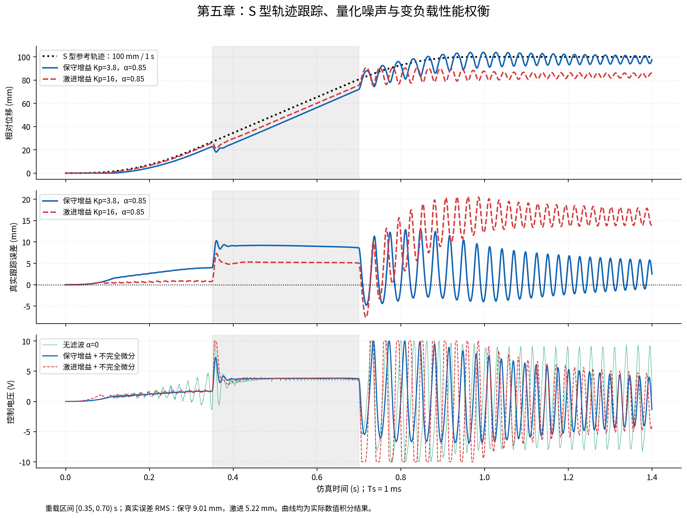
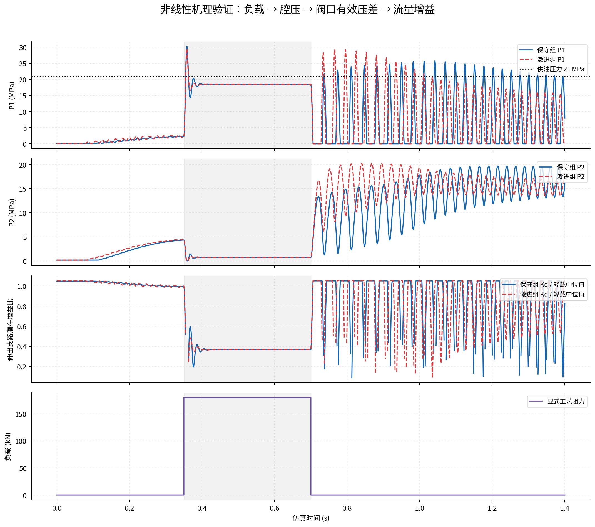
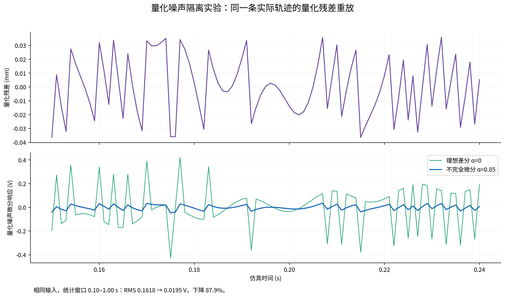
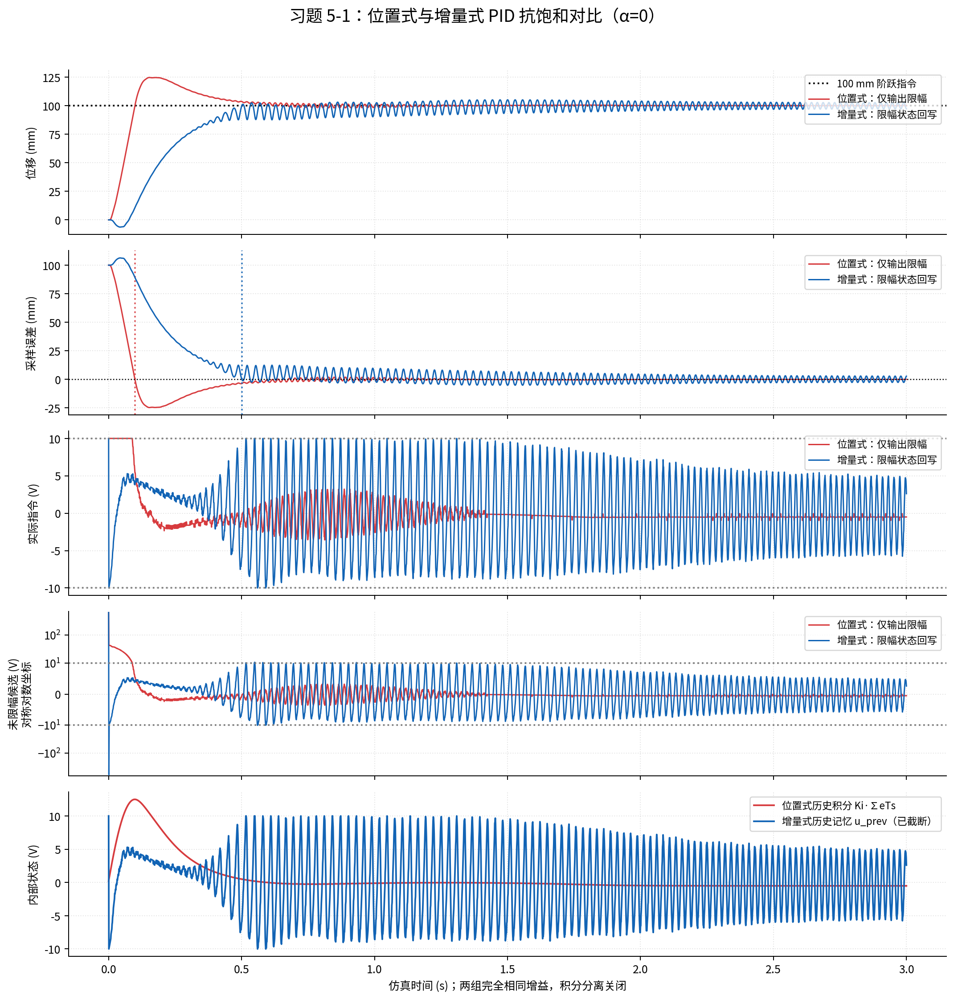
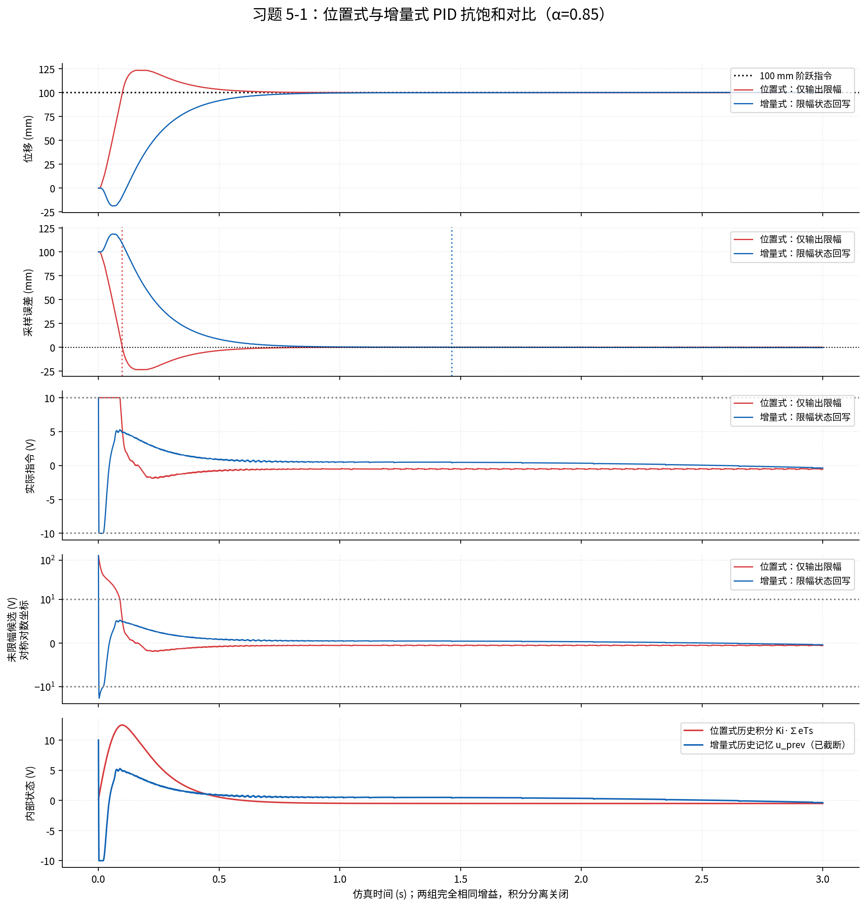

# 第五章 数字 PID 闭环控制实验报告

基于第三、四、五章课件、上传 HydraulicTwin 与 Word 中的数字 PID、S 型轨迹代码，完成三组课堂实验及教材习题 5-1。报告内数值来自本次非线性闭环运行；示意图中的 65% 增益衰减、约 17.4 mm 滞后和稳定性描述不作为预设输出。

## 1 实验目标与依据

课堂实验分别比较保守增益、激进增益和未滤波微分，观察 S 型跟踪、量化噪声及变负载下流量增益与动态误差的变化。习题 5-1 在相同增益和限幅下比较位置式历史积分与增量式截断输出记忆，提取误差首次非正和退出 +10 V 的时刻。课件的 1.0 s 完成 100 mm 定位、误差小于 0.05 mm 是验收目标，是否达到须由实际误差判断。

## 2 模型、采样与参数

上传的 hydraulic_digital_twin.py 保持原样。闭环子类按第三章孔口方程补充压差符号回流，避免超过供油或回油压力时仍强制原流向；保留原四状态液压动力学，并增加一阶实际阀芯响应。低压体积模量采用蒸气压 Pv=2 kPa 的气穴等效近似，不构成完整多相气穴模型。压力不通过事后裁剪伪造。原 Twin 在 x=0.4 m 激活的工件接触负载在闭环中禁用，替换为明确的时间窗外载，避免两个负载叠加。

| 项目 | 本次设定与含义 |
| --- | --- |
| 液压主体 | 质量 500 kg；A₁=0.010 m²、A₂=0.005 m²；供油 21 MPa、回油 0.1 MPa；其余见 physical_config.json |
| 初始状态 | 初始绝对位置 0.050024 m 对齐 ADC 代码；速度为零，两腔初压 0.1/0.2 MPa 实现液压力平衡；报告位移相对该原点 |
| 采样及执行 | Ts=1 ms，控制电压 ±10 V，阀命令为 u/10；每周期零阶保持（ZOH） |
| 传感器 | 12 bit、0～300 mm；LSB=0.07324219 mm；四舍五入量化，代码饱和 0～4095 |
| S 型参考 | 目标 100 mm，运动段 1.0 s，总时长 1.4 s；七段比例 0.10/0.15/0.10/0.30/0.10/0.15/0.10 |
| 工艺外载 | t∈[0.35,0.70) s 施加 180.0 kN 阻力，其余时刻为零；加载/卸载与采样边界对齐 |
| 阀芯滞后 | τ=15 ms；补充一阶响应参数 |
| 数值积分 | 每个 ZOH 周期调用隐式 Radau；相对容差 rtol=1e-05；切换时窗逐周期锁存 |

180 kN 人为外载、15 ms 阀芯时间常数、Pv=2 kPa 和 physical_config.json 中补齐的参数是用于复现教学闭环的明确仿真假设。这些参数未经真实设备辨识；程序运行和数值检查通过并不等于模型已经得到实验验证。因此不能把本次曲线直接解释为实际液压机的已验证性能。

原对象未配置补油阀、溢流阀及管路分布参数。卸载时腔压可能高于 21 MPa 供油压力，低压腔也可能接近 2 kPa 气穴近似下限；本报告按实际压力极值原样记录。约 30 MPa 的瞬态峰值属于这一简化封闭模型的响应，不能当作实际系统已得到安全验证的运行压力。在真实设备分析中需要补齐上述压力保护、补油及气穴物理。

感知→量化→PID→限幅→ZOH→Radau 的顺序每 1 ms 执行一次。时间刻度为 t[k]=kTs，共 1401 个采样点，包含两端；1.400 s 对应 N=1400 个物理积分区间，CSV 记录 N+1 行。末端电压是该采样点的决策值，不计入已经完成的 ZOH 饱和持续时间。

## 3 轨迹与数字 PID 实现

七段 S 型轨迹逐段对常跃度解析积分，联合生成位置、速度和加速度。位置、速度、加速度在段边界连续，跃度有界并允许阶跃；t≥1.0 s 后参考保持 100 mm，速度和加速度为零。解析边界条件消除原示例 linspace 点数与 dt 不一致、逐级数值积分累积偏差的问题。

Twin 内部采用 SI 单位。PID 接口接收 m，在内部将误差乘 100 转为 cm；Kp 单位为 V/cm，Ki 为 V/(cm·s)，Kd 为 V·s/cm，输出为 V。换成毫米或米时必须同步换算增益，否则无法复现 Word 的整定。

不完全微分：D[k]=αD[k−1]+(1−α)(Kd/Ts)(e[k]−e[k−1])。增量式：Δu[k]=Kp(e[k]−e[k−1])+Ki e[k]Ts+D[k]−D[k−1]；u[k]=clip(u[k−1]+Δu[k],−10,+10)，截断后的实际 u[k] 写回记忆。位置式：I[k]=I[k−1]+Ki e[k]Ts；u_calc[k]=Kp e[k]+I[k]+D[k]，只对最终输出限幅，内部 I[k] 继续累加。

课堂组保留 Word 的积分分离：|e|≥0.15 cm（1.5 mm）时积分增量乘 0.05，小误差恢复 1。习题 5-1 两类控制器均关闭积分分离，防止额外抗饱和措施掩盖位置式与增量式的结构差异。增量式的 raw_voltage_v 表示本步限幅前候选值，不是跨周期保留的未截断输出。

## 4 三组课堂实验结果

Word 给出课堂 Kp=3.8/16.0 和 α=0.85/0，但没有提供课堂 Ki、Kd 的具体实例化值。本程序公开补充默认 Ki=22.0、Kd=0.06，取课件习题中的数值作为共同基准；它们不是对上传 Twin 已完成辨识或稳定整定的结果。

| 实验 | Kp / V·cm⁻¹ | Ki / V·cm⁻¹·s⁻¹ | Kd / V·s·cm⁻¹ | α |
| --- | --- | --- | --- | --- |
| 保守增益 + 滤波 | 3.8 | 22.0 | 0.06 | 0.85 |
| 激进增益 + 滤波 | 16.0 | 22.0 | 0.06 | 0.85 |
| 保守增益 + 无滤波 | 3.8 | 22.0 | 0.06 | 0.00 |

| 真实闭环指标 | 保守 + 滤波 | 激进 + 滤波 | 保守 + 无滤波 |
| --- | --- | --- | --- |
| 重载最大绝对误差 / mm | 10.3268 | 7.3075 | 14.0442 |
| 重载误差 RMS / mm | 9.0142 | 5.2182 | 13.3312 |
| 1.0 s 真实误差 / mm | -3.4120 | 12.4157 | 21.9281 |
| 末 200 ms 最大绝对误差 / mm | 6.7539 | 18.5143 | 27.6875 |
| 末 200 ms 误差 RMS / mm | 3.5893 | 16.0037 | 21.4388 |
| 末端真实误差 / mm | 2.5436 | 14.1186 | 26.3932 |
| 1.1 s 至末端误差峰峰值 / mm | 10.4724 | 5.7150 | 12.7327 |
| 1.1 s 至末端电压峰峰值 / V | 11.9673 | 13.6167 | 17.6660 |
| 最大绝对输出电压 / V | 10.0000 | 10.0000 | 10.0000 |
| 最低绝对腔压 / MPa | 0.002004 | 0.002005 | 0.002001 |
| 最高绝对腔压 / MPa | 30.2437 | 29.5742 | 34.2396 |

激进组重载误差 RMS 为 5.2182 mm，相对保守组的 9.0142 mm减小 42.11%；卸载后 1.1 s 至末端真实误差峰峰值分别为 10.4724 mm 和 5.7150 mm。重载跟踪与卸载波动须同时比较，单纯提高比例增益不能自动证明整体性能改善。这里记录的是有限时窗内的波动，未进行相位裕度或极限环的严格稳定性证明。

本次阀芯响应为 15 ms，保守组卸载后 1.1 s 至末端实测误差峰峰值为 10.4724 mm。不能依据较低的 Kp 直接断言“保守组卸载无振荡”。真实非线性 Twin 的结果与示意图不同，是本实验需要说明的结果；没有人为叠加正弦信号，也没有通过画图强制制造或消除振荡。

## 5 流量增益机理与量化噪声

正向伸出且 Ps>P₁ 时，Kq=Cd·w·√[2(Ps−P₁)/ρ]，单位 m²/s。负载提高驱动腔压力会缩小阀口有效压差，使 Kq 按平方根规律下降；卸载则使物理增益回升。统计轻载区间固定为 [0.25,0.34) s，重载区间固定为 [0.50,0.65) s，取各区间中位数以避开加载瞬态。下表的下降百分比从两区间 Kq 中位数计算，不使用预设 65%。

全时 Kq 曲线按当前 P₁ 计算伸出支路的潜在增益，未按实际阀芯方向筛选。阀反向时，它不代表当前反向支路的局部流量增益；Ps≤P₁ 时记录为缺失值。本次默认轻载与重载统计窗内阀芯均为正向，下降百分比用于这两处有效伸出工况。

| 机理指标 | 保守 + 滤波 | 激进 + 滤波 | 保守 + 无滤波 |
| --- | --- | --- | --- |
| 轻载 P₁ 中位数 / MPa | 2.0221 | 2.1555 | 0.4146 |
| 重载 P₁ 中位数 / MPa | 18.4430 | 18.4422 | 18.4437 |
| 轻载 Kq 中位数 / m²·s⁻¹ | 2.590005 | 2.580888 | 2.697469 |
| 重载 Kq 中位数 / m²·s⁻¹ | 0.950703 | 0.950839 | 0.950560 |
| 重载 Kq 下降 / % | 63.29 | 63.16 | 64.76 |

12 bit、300 mm 量程的 1 LSB 为 0.07324219 mm。Ts=1 ms 时，后向差分中的 1/Ts=1000 s⁻¹；在 Kd=0.06 V·s/cm 下，1 LSB 单步跳变对应 0.439453 V 的未滤波微分变化。不能把 1000 倍直接当作电压幅值，它还依赖单位换算与 Kd。

闭环未滤波组与滤波组的轨迹可能不同，直接比较电压并不能独立归因于量化噪声。因此另取同一保守组真实轨迹的量化残差 q[k]=x[k]−y_ADC[k] 重放，设置 Kp=Ki=0、Kd=0.06，只比较微分通道 α=0 与 α=0.85。此残差是测量量化误差，区别于参考与真实位移之差的闭环跟踪误差。

| 同轨迹量化残差重放（0.1～1.0 s） | 本次结果 |
| --- | --- |
| 未滤波微分电压 RMS / V | 0.161828 |
| α=0.85 微分电压 RMS / V | 0.019509 |
| 微分电压 RMS 降低 / % | 87.94 |

## 6 习题 5-1：抗积分饱和对比

两组输入均为 100 mm 阶跃，Kp=4.2、Ki=22.0、Kd=0.06，输出限幅 ±10 V、Ts=1 ms、12 bit 传感器及相同物理模型。主比较按教材标准差分取 α=0，不加积分分离；补充比较让两组共同取 α=0.85，其他条件保持一致。作业使用无工艺外载工况，以聚焦执行器饱和与内部状态结构。

本次习题仿真时长为 3 s，长于课堂 S 型实验，以记录饱和、反向与后续响应；末 200 ms 统计只描述尾段响应，不将其直接称为渐近稳态误差。

### 6.1 教材式主比较（α = 0）

| 指标 | 位置式 PID | 增量式 PID |
| --- | --- | --- |
| 真实误差首次 ≤ 0 / s | 0.0990 | 0.5010 |
| 量化反馈误差首次 ≤ 0 / s | 0.0990 | 0.5010 |
| 首次退出 +10 V / s | 0.0900 | 0.0010 |
| 首次退出 − 量化误差过零 / s | -0.0090 | -0.5000 |
| 量化误差过零后退出 +10 V / s | — | 0.5180 |
| 量化误差过零时输出 / V | 5.4147 | -5.8751 |
| 超调 / mm | 24.6473 | 5.0957 |
| 实际位移峰值 / mm | 124.6473 | 105.0957 |
| ±10 V 饱和总时长 / s | 0.0900 | 0.0220 |
| 限幅前候选电压最大值 / V | 642.2200 | 642.2200 |
| 限幅前候选电压最小值 / V | -3.5738 | -589.7800 |
| 末 200 ms 真实误差 RMS / mm | 0.0109 | 1.9741 |

两组首采样限幅前电压分别为 642.22 V、642.22 V，实际输出均受 ±10 V 约束。阶跃在 t=0 输入，控制器以零误差历史初始化，所以微分项包含参考阶跃引起的 derivative kick。退饱和事件由实际采样序列提取；首次退出可以早于误差过零，负的时间差必须保留，不能用零代替。

本组位置式超调 24.6473 mm，增量式超调 5.0957 mm；增量式相对位置式减小 79.33%。两组首次退出 +10 V 的时刻为 0.0900 s、0.0010 s，量化误差过零时输出为 5.4147 V、-5.8751 V。应结合图中的积分状态、限幅前候选量和实际电压判断迟滞，不能只用一次退饱和时间代表全过程。

### 6.2 共同滤波补充比较（α = 0.85）

| 指标 | 位置式 PID | 增量式 PID |
| --- | --- | --- |
| 真实误差首次 ≤ 0 / s | 0.0990 | 1.4140 |
| 量化反馈误差首次 ≤ 0 / s | 0.0990 | 1.4630 |
| 首次退出 +10 V / s | 0.0900 | 0.0010 |
| 首次退出 − 量化误差过零 / s | -0.0090 | -1.4620 |
| 量化误差过零后退出 +10 V / s | — | — |
| 量化误差过零时输出 / V | 5.2844 | 0.4003 |
| 超调 / mm | 23.4747 | 0.3877 |
| 实际位移峰值 / mm | 123.4747 | 100.3877 |
| ±10 V 饱和总时长 / s | 0.0900 | 0.0190 |
| 限幅前候选电压最大值 / V | 132.2200 | 132.2200 |
| 限幅前候选电压最小值 / V | -1.9030 | -19.5338 |
| 末 200 ms 真实误差 RMS / mm | 0.0101 | 0.3643 |

两组首采样限幅前电压分别为 132.22 V、132.22 V，实际输出均受 ±10 V 约束。阶跃在 t=0 输入，控制器以零误差历史初始化，所以微分项包含参考阶跃引起的 derivative kick。退饱和事件由实际采样序列提取；首次退出可以早于误差过零，负的时间差必须保留，不能用零代替。

本组位置式超调 23.4747 mm，增量式超调 0.3877 mm；增量式相对位置式减小 98.35%。两组首次退出 +10 V 的时刻为 0.0900 s、0.0010 s，量化误差过零时输出为 5.2844 V、0.4003 V。应结合图中的积分状态、限幅前候选量和实际电压判断迟滞，不能只用一次退饱和时间代表全过程。

### 6.3 状态记忆与退饱和解释

位置式在正误差期间继续积累 I[k]。即使输出已经达到 +10 V，其内部积分仍可能增长；当比例项或误差反向后，积累的 I[k] 会继续支撑正向输出，形成退饱和迟滞和额外超调。限幅前候选电压和独立积分状态体现这一机制。增量式把本周期截断后的实际输出写回 u[k−1]，不跨周期保留超出电压边界的候选值，因此阻断这种无效输出累积；图中的积分增量并非位置式的全历史积分。

对本次 100 mm 阶跃，初始误差为 10 cm。未滤波首步候选电压为 4.2×10+22×10×0.001+0.06×10/0.001=642.22 V；共同滤波 α=0.85 时为 42+0.22+0.15×600=132.22 V。滤波或未滤波微分 kick 在下一步衰减，会产生明显负控制增量，使增量式可能在误差仍为正时首次退出 +10 V，甚至转为负限幅。所以课件中“一旦误差反向即可立即退出”必须理解为截断输出记忆减少 windup 的结构特点，而不是本实验每次过零都会即时退饱和的保证；退出仍由总控制增量和状态决定。

事件定义：误差过零取采样误差首次 ≤0 的采样点，并另列真实误差事件；退出 +10 V 取相邻采样中从正饱和变为非正饱和的首个点。另外列出过零之后发生的退出事件，避免将早期微分 kick 引起的退出误当作反号退饱和。表中“—”表示仿真时窗内未观测到相应事件或不适用；所有事件时刻分辨率为 1 ms。饱和总时长统计 ±10 V 的 ZOH 区间，末端单独采样不增加持续时间。

## 7 指标验收与结论

| 课堂组 | 1.0 s 误差 / mm | 1.0 s \|e\|<0.05 mm | 末 200 ms 最大 \|e\| / mm | 保持窗 <0.05 mm |
| --- | --- | --- | --- | --- |
| 保守 + 滤波 | -3.4120 | 未达到 | 6.7539 | 未达到 |
| 激进 + 滤波 | 12.4157 | 未达到 | 18.5143 | 未达到 |
| 保守 + 无滤波 | 21.9281 | 未达到 | 27.6875 | 未达到 |

S 型参考在 1.0 s 到达 100 mm，不等于执行机构同一时刻完成精密定位。上表将 1.0 s 瞬时真实误差与保持窗口最大真实误差分别验收。12 bit 量化反馈的一个代码对应约 0.07324 mm，某个量化读数不变化并不能证明真实位移稳定在 0.05 mm 以内。有限 1.4 s 仿真也不等同于渐近稳定性证明。

本实现完成了数字 PID、先滤波后增量、实际输出限幅记忆、七段解析轨迹、1 kHz ZOH 闭环和非线性 Twin 联接，并按实际数据报告负载增益变化、量化噪声抑制及习题 5-1 退饱和过程。若固定 PID 未达到课件精密定位指标，应保留失败指标作为性能边界证据，进一步研究第六章压力/流量非线性补偿与前馈或后续约束预测控制，不能通过预设响应曲线替代物理仿真结果。

## 8 复现与数据说明

进入解压后的 chapter5 目录，执行 python -m pip install -r requirements.txt 安装依赖，再执行 python digital_pid_lab.py 重算全部七组实验。默认 outputs/ 中生成 CSV/JSON、五幅图和本报告。执行 python -m unittest -v test_chapter5 可运行实现检查。控制采样间隔固定为 1 ms；CSV 的 time_s 包含 t=0 和终点。SI 原始数据保存位置、速度、参考、腔压、量化测量、真实/采样误差、实际/候选电压、微分项、积分状态或单步积分增量、阀芯状态、外载和 Kq。summary.json 是报告定量结果的依据；quantization_probe 对同轨迹量化残差重放。

材料依据：第五章课件第 3～8 页（离散 PID、微分滤波和硬限幅）、第 9～14 页（S 型轨迹、离散时序和流量增益）、第 16 页（习题 5-1）；第三章的阀口压差符号和阀控缸模型；第四章的参数辨识与时间基准对齐（未提供测量数据，本次沿用标称参数）；Word 的 DigitalPID 与 generate_scurve 两段代码。原始 Twin 保留；闭环接口和补充假设在模型说明中明确列出。
