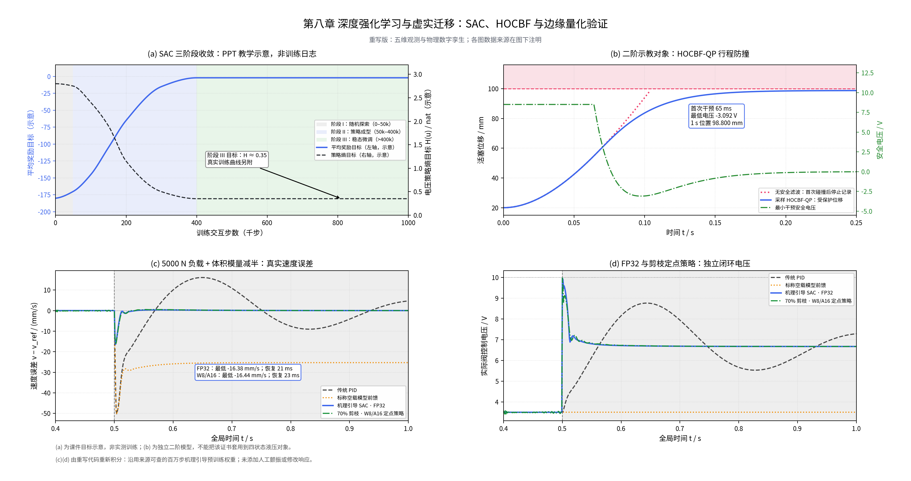

# 第八章课堂编程实践：重写版

本目录重新实现了《智能流体传动与控制》第八章的数字孪生、五维 Gymnasium 环境、SAC 训练、HOCBF 最小干预安全滤波及剪枝量化。全部运行逻辑集中在 **`drl_hydraulic_lab.py`**，不会导入此前项目的 Python 文件。附带的 `test_drl_hydraulic_lab.py` 用于开发验证，运行实验不依赖该文件。

主图按此前确认的方式呈现：**(a) 明确标注为 PPT 教学示意，(b) 为独立二阶对象的安全实验，(c)(d) 为同一个四状态液压对象上的真实闭环积分。** 真实训练记录另外保存。复现主图使用的冻结权重与本次从零训练权重是两组独立资产，不能混用结果。



## 运行

建议 Python 3.11 或 3.12。在本目录执行：

```bash
python -m venv .venv
# Linux / macOS
source .venv/bin/activate
# Windows PowerShell 对应：.venv\Scripts\Activate.ps1
python -m pip install -r requirements.txt
python drl_hydraulic_lab.py
```

默认命令重新计算四组闭环、安全实验、主图和指标，并用独立 Radau 求解器重放电压检查状态轨迹。主要结果写入 `outputs/`。默认可复现实验需要随附的 `assets/` 目录及其 `provenance.json`，不是只复制一个 Python 文件后自动获得已训练策略。

| 命令 | 用途 |
| --- | --- |
| `python drl_hydraulic_lab.py` | 使用附带冻结权重重新积分、绘图与验证 |
| `python drl_hydraulic_lab.py --mode safety` | 独立二阶 HOCBF-QP 实验，验证至 1 s |
| `python drl_hydraulic_lab.py --mode verify` | 对已有 `outputs/evaluation.csv` 做独立重放与来源核验 |
| `python drl_hydraulic_lab.py --mode plot` | 从已有 CSV 重新绘图，不重新训练 |
| `python drl_hydraulic_lab.py --mode robustness` | 固定种子验证12组留出参数、两种神经网络策略 |
| `python drl_hydraulic_lab.py --backend radau --output outputs_radau` | 使用纯 Python/SciPy 刚性积分后端重算 |
| `python -m unittest discover -s . -p 'test_drl_hydraulic_lab.py' -v` | 运行开发验证 |

`--backend auto` 在支持的平台有 `g++` 时编译主文件内嵌的同方程 C++ 积分器作为加速；无编译器或平台不支持时自动使用 SciPy Radau。因此 **Windows 无须安装 g++**，也不依赖交付目录外的源文件。Radau 与原生积分器使用相同物理方程，数值截断误差可能略有不同；Radau 从零训练会显著更慢。绘图默认保存文件，桌面环境可以增加 `--show`。

## 从零运行 SAC

训练需要额外安装 PyTorch 和 Stable-Baselines3：

```bash
python -m pip install -r requirements-train.txt
python drl_hydraulic_lab.py --mode train --timesteps 1000000 --seed 2026 --output training_runs
```

训练会在指定输出目录内创建唯一子目录，保存实际交互 CSV、初始和最终 SAC 检查点、每 10 万步的检查点、源代码快照、版本与随机种子、量化校准/验证数据以及独立故障测试结果。它不会覆盖主目录已附的冻结权重。

本次重写的 `train_agent` 使用随机初始化的原生 SAC：**不导入旧模型，不进行教师预训练，不加教师损失，也不在 SAC 结束后改写 FP32 演员权重。** 四个环境的实际交互数合计为 100 万步，前 5 万步均匀动作探索；之后按记录的频次更新。`--timesteps 10000` 可检查训练流程，但这只是短时冒烟实验，不能称为百万步训练或已收敛。

环境的教材奖励保持原值。仅优化器包装器使用 `0.001` 的数值比例，原始奖励与该比例分别记录。曲线按最近 10,000 个实际交互步的原始教材奖励统计；额外的终止成本单独记录。熵来自当前 replay 状态上的采样，包含 tanh 雅可比，并按 `H(u) = H(a) + ln(10)` 换算到伏特动作。微分熵可能为负，不能把 `log_std` 或温度系数直接当成策略熵。

本次运行的真实日志、检查点、代码快照与闭环结果随附于 **`fresh_training/`**；以其中 `models/training_metadata.json`、`outputs/training.csv`、`outputs/metrics.json` 的实测值为准。它们对应新训练，主图 `outputs/` 中的策略仍是下文注明来源的历史冻结策略。新权重的 70% 剪枝与量化须重新检查闭环，不能继承旧权重的 21/23 ms 指标；若不满足控制目标，结果仍如实保留，不替换成旧模型。

本次已实际完成 **1,000,000 步交互、118,750 次梯度更新、716 个回合**，训练约 535 秒。固定10k步原始奖励从首窗 **−11257.73** 改善至末窗 **−2.161**；最后10万步的平均电压策略熵约 **0.337 nat**。这是本次真实训练，不能将其起点改画为PPT的−180。

- [本次真实训练曲线](fresh_training/outputs/sac_training_actual.png)
- [本次新权重独立闭环对比](fresh_training/outputs/chapter8_comparison.png)
- [本次训练和控制指标](fresh_training/training_summary.json)

新FP32策略的故障速度谷值为 **−18.58 mm/s**，持续恢复至±1mm/s耗时 **78 ms**；故障前速度RMS误差仍为 **4.98 mm/s**，存在控制抖动。直接剪枝70%后的新量化策略谷值 **−40.20 mm/s**，本窗口未持续恢复，**不具备交付部署性能**。因此主图使用此前选定且通过重放的稳定策略；本次新策略及其量化退化均单独保留，未用旧权重或旧曲线替换。`fresh_training/assets/provenance.json` 中 `deployment_ready=false` 明确表示仍须进一步调优与验证。

`fresh_training/source_snapshot.py` 是训练启动时的完整代码快照。训练期间只改进了最终评估/绘图的来源标注及失败保存方式；环境、物理核和训练函数与最终主程序逐项SHA256一致，记录在 `fresh_training/delivery_provenance.json`。原始训练CSV、SB3模型和导出FP32权重保持原字节，未作训练后改写。新策略存在高频切换，最终闭环采用带误差控制的Radau，并以DOP853独立重放；原固定RK子步结果及未通过的数值校验保存为 `fresh_training/outputs/native_*`，未抹去。

## 与 PPT、课堂要求及参考代码的对应

| 章节 | 本次实现 | 验证口径 |
| --- | --- | --- |
| 8.1 MDP 与式 8.1 | `HydraulicGymEnv`，归一化一维连续动作、五维 Z-score 特征、四项教材奖励 | `reset(seed=...)` 可复现，奖励逐项可检查 |
| 8.2 SAC 与式 8.2 | `train_agent` 调用 SB3 SAC，随机策略训练、确定性均值独立评估 | 保留实际交互日志，不用插值曲线代替训练数据 |
| 8.3 式 8.3–8.5 | `HOCBFSafetyFilter` 的标量最小距离 QP，连续参考公式与采样保持认证分别实现 | 二阶对象上检查全部保持区间；空可行集报错 |
| 8.4 域随机化 | 每回合随机质量 ±20%、标称体积模量 600–1400 MPa、库伦摩擦 ±30% | 使用 Gym 自带的 `np_random`，随机参数真实进入受力及连续性方程 |
| 8.5 代码清单 8.1 | `HydraulicTwinCore` + Gymnasium 环境 + 故障测试 | 所有控制策略共用初态、对象、负载与积分方法 |
| 8.6 式 8.6 | `EdgeLightweightExporter` 提供幅值剪枝、仿射量化；`IntegerActor` 运行整数网络内核 | 区分权重量化反量化浮点推理与真正整数乘加 |

五维原始特征为 `[x-r, v-v_ref, a-a_ref, PL, Ps]`，前三项采用 mm、mm/s、mm/s²，压力采用 MPa；`PL = P1 - (A2/A1)P2`。标准化均值为 `[0, 0, 0, 10, 21]`，标准差为 `[10, 50, 500, 8, 2]`。误差统一采用 **实际值减参考值**，所以负速度误差表示速度跌落。动作 `a∈[-1,1]` 映射为 `u=10a` V。

教材奖励为：

```text
r = -100 * e_mm² - 0.1 * u_V² - (u_V - u_prev_V)²
    + 2.0 * I(abs(e_mm) < 0.2)
```

五维观测是课堂规定的压缩特征。它没有包含全部未知物理参数或上一动作，因此不据此声称严格完全可观测。加速度来自当前状态力平衡的理想无噪传感值，没有向网络输入外部故障标签、未来负载或真实负载参数。

## 参考片段中的问题与本次处理

1. **物理量与积分一致性。** 上传训练片段里的简化离散更新不能完整体现质量、摩擦与两腔压力的作用，部分压力更新缺少明确时间尺度。本次统一为 SI 四状态 `[x,v,P1,P2]` 的力平衡、两腔连续性及有向孔口方程。质量、摩擦、体积模量随机化均改变真实右端项。物理压力与运动状态不通过裁剪制造安全或平滑曲线。
2. **随机种子与观测。** 使用 `reset(seed=...)` 对应的环境随机源，而不是与 Gym 种子脱节的全局随机数。动作、观测、参数更新及失败处理均有明确检查。标准化仅发生在网络入口，物理对象始终使用 SI。
3. **训练与示意。** PPT 未附原始百万步日志，因此不能强行把实际训练记录变成 `−180→−2` 或把熵强制改成 `0.35`。主图 (a) 是有明确标注的教学示意；实际历史训练与本次新训练各自保留原始 CSV 及来源。
4. **二阶安全公式的适用条件。** 用户片段中的 `alpha1=48, alpha2=580` 被保留在 `reference_bounds()`；这两个数无法分解为正实递归增益的和与积，因为 `48²−4×580<0`。因此该参考连续公式不被描述为任意采样周期下的严格安全证明。实际演示显式选择正递归增益 `κ1=κ2=49 s⁻¹`，对整个 1 ms 保持区间求约束极值，并检查初始高阶安全条件。空 QP 不再静默返回一个仍不可行的“安全”电压。
5. **相对阶。** 二阶安全演示采用 `x'=v, v'=2.64u−14v`（SI）。四状态油压对象从电压到位移的相对阶为三；其安全证明不能由二阶演示直接替代。增加阀芯状态还会再次改变相对阶。本目录没有把二阶证书套在真实液压闭环上。
6. **量化与部署。** 原片段反量化后返回浮点权重只能展示量化误差，不能证明已做整数推理。本次另外实现 INT8 权重、INT16 激活、INT32 累加及 INT64 重定标；入口仿射变换与末端 tanh 仍为浮点。剪枝属于幅值非结构化剪枝，不等于减少所有矩阵维度，也不能仅凭 70% 零权重推断固件缩小 70%。

物理模型使用可导孔口正则化、低压补油和 25 MPa 泄压通路；摩擦为连续 tanh-Stribeck 滑动近似，未实现集合值静摩擦粘住事件。公开教学几何采用 `A1=0.00038 m²`、`A2=0.00021 m²`、质量 250 kg、供油压力 21 MPa，使 5000 N 成为显著重载；它不是将第六章的大面积油缸参数原样套用。参数和右端项均写在主文件及 `outputs/metrics.json`，并非从目标曲线反填输出。

## 主图的来源与实测结果

**(a) 教学示意。** 根据第八章 PPT 第 12 页及给定图的三阶段趋势构造 PCHIP 插值，记录锚点与选择于 `outputs/ppt_schematic_source.json`，不生成假训练 CSV，不添加伪随机训练波动。400k 之后的熵约 0.35 是参考目标，不是当前真实训练的保底结果。确定性闭环也没有人为叠加颤振；本次不以有非零熵这一事实单独证明已消除物理静摩擦爬行。

**(b) 独立二阶安全实验。** 初态 20 mm、零速度，提出恒定 +8.5 V 指令，机械边界 100 mm，内部保留 1.2 mm 裕量。对象增益 2640 mm/(s²·V)、阻尼 14 s⁻¹；它们是声明的示教参数。1 秒采样保持验证得到：首次介入 **65 ms**，最低电压 **−3.0916 V**，终点 **98.8 mm**。未保护对象在 **104.891 ms** 首次碰撞后停止记录，不把曲线继续画成伪造的碰撞平台。图示只展示前 0.25 s，完整验证到 1 s。

**(c)(d) 共用四状态对象的真实重算。** 四种策略都从同一空载 50 mm/s 平衡态开始；在全局 0.50 s 同时施加 5000 N 负载及油液体积模量乘 0.5，观察区间为 0.40–1.00 s。控制电压与速度直接来自闭环，不插值造峰，不平滑后冒充实测，也不添加人工噪声/颤振。

下表来自本目录 `outputs/metrics.json`，对应**已附历史冻结策略**，不是本次随机初始化的新训练：

| 策略 | 故障后最低速度误差 / mm/s | 恢复到并持续保持 ±1 mm/s | 末 100 ms 平均电压 / V |
| --- | ---: | ---: | ---: |
| 传统 PID | −50.164 | 本窗口未达标 | 6.863 |
| 标称空载模型前馈 | −50.297 | 本窗口未达标 | 3.510 |
| 机理引导 SAC，FP32 | −16.376 | 21 ms | 6.679 |
| 约 70% 剪枝，W8/A16 | −16.443 | 23 ms | 6.678 |

“恢复时间”从故障时刻计算，在最大绝对偏差之后寻找首个到记录结束始终落入 ±1 mm/s 的时刻，同时要求其后至少保留 50 ms。它不是首次穿过零点或短暂进入误差带的时间。FP32 与定点闭环的显示窗口速度 RMS 差约 **0.146 mm/s**。

PPT 中“PID −48 mm/s、前馈最终 −26 mm/s、SAC −14.1 mm/s、9.10 V 峰值及 6.50 V 稳态”等是参考图的标度，本次同对象实测不完全一致。附带 SAC 实际峰值约 9.97 V、稳态约 6.68 V。不会为获得图形一致而将原始响应改写成这些数字。

12组固定种子的额外参数验证保存在 `outputs/parameter_robustness.json`：两种策略各完成12组仿真，其中各9组在80ms内恢复；最差速度谷值约为FP32 −30.78、定点 −31.06mm/s。域随机化扩大了训练覆盖范围，但不能保证全部参数组合都达到标称性能。

## 已附权重与新训练的来源

默认 `assets/` 来自用户此前选定的仓库版本：

```text
仓库：https://github.com/cran506/a
历史提交：780f0dc8de0e4f534f45b4351c3924deecac1791
原目录：chapter8_reference/models
```

该策略完成过真实百万步环境交互，但训练方法是**机理教师引导 SAC**，并有另外记录的离线教师/Jacobian 精修与稀疏策略蒸馏。它不是“本次重写代码从零训练出的 vanilla SAC”，也不能将离线精修记为额外 SAC 交互。`provenance/` 保留原训练 CSV、训练元数据、教师初始化和精修记录；完整历史训练源码与完整检查点可追溯至上述提交。

本次重新实现 FP32 与整数运行时，并逐项核对冻结模型：1,202 个观测的整数动作与原实现完全一致；FP32 对照原 SB3 演员均值头的最大归一化动作差为 `2.3842e−7`。各模型 SHA256 与字节数保存在 `assets/provenance.json`；加载时核查，篡改会被拒绝。

`outputs/sac_training_actual.png` 对应的是该历史机理引导训练日志，**不包含后续离线精修**。本次新训练的曲线在 `fresh_training/outputs/`，其原始策略、训练方法及文件哈希独立记录。对这两组不同方法的训练曲线不能互相替换。

## 整数部署的范围

默认边缘策略为 **W8/A16**，不能简写成“全 INT8 部署”。权重为 INT8，激活为 INT16，累加为 INT32，重定标暂存为 INT64；末端 tanh 及输入标准化仍用浮点。`prune_and_quantize_weights()` 保留了参考要求的仿射量化演示；实际闭环使用 `IntegerActor`。

附带 NPZ 文件的压缩后体积为 FP32 18,421 字节、整数资产 9,003 字节，实际文件大小还包含元数据、每通道比例与偏置；该比例不等于 MCU 固件体积或完整 SAC 模型压缩率。稠密数组保存零权重，也不会自动获得稀疏硬件加速。

当前主机的 NumPy 单观测内核测量约为 FP32 **0.009 ms**、整数 **0.039 ms**，每次重跑会变化。其范围仅是当前 CPU 的演员计算，不含积分、采集或安全滤波；NumPy 整数路径在本机也不一定比浮点快。**没有将 PPT 的 0.06 ms、20.1 KB 等数字预填成实测 MCU 结果；未在 ARM/DSP 真机上验证。**

[下载完整交付包](deliverables/第八章_课堂编程_重写版.zip)

## 文件与验证

| 路径 | 内容 |
| --- | --- |
| `drl_hydraulic_lab.py` | 唯一实验运行主文件，含物理方程、环境、训练、滤波、整数运行时、评估与绘图 |
| `assets/` | 默认重放所需冻结 FP32/剪枝/定点策略及来源哈希 |
| `materials/` | 本章课件及上传参考片段，作为资料保留 |
| `provenance/` | 历史训练与离线精修的原始证据 |
| `outputs/chapter8_comparison.png`、`.pdf` | 四面板主图，图上注明各面板来源 |
| `outputs/evaluation.csv` | 四组策略的原始逐采样电压、速度、位置和两腔压力 |
| `outputs/safety.csv` | 独立二阶对象的原始轨迹 |
| `outputs/metrics.json` | 参数、指标、模型来源及主机推理计时 |
| `outputs/verification.json` | 独立 Radau 电压重放、闭环再现与模型哈希校验 |
| `outputs/sac_training_actual.png`、`.pdf` | 历史真实 SAC 日志，另附于教学示意之外 |
| `fresh_training/` | 本次随机初始化的原生 SAC 实际训练与独立结果 |
| `test_drl_hydraulic_lab.py` | 开发测试，不被实验主程序导入 |

独立重放使用保存的原始电压，再次积分四状态方程，对比速度、位置与压力，并独立重新运行网络闭环，以检查数据没有被手动平滑或替换。当前结果的四组电压重放及模型哈希检查均通过。二阶 HOCBF 的全部保持区间检查通过；随机可行状态另有独立数值积分对照。**方法、数值与来源检查通过，并不等于四状态液压对象具备二阶证书，或所有 PPT 性能数字都已经达成。**
