# 变负载液压伺服系统的多阶控制算法设计与对比

学号后四位：0795；种子：795。当前范围不含第八章。

# 第1章 绪论

## 1.1 工程背景与研究意义

液压伺服系统利用节流流量与腔室压差驱动执行机构，适用于锻压、重载定位及大型试验装备。其功率密度较高，但控制对象同时包含非对称面积、油液可压缩性、运动摩擦、阀口平方根流量和驱动死区。不同工况下的控制增益并非常数，线性定常控制器在轻载下整定后，不能自然保持重载时相同的动态品质[1-2]。

变负载工况具有两类不同影响：外力跳变直接破坏瞬时力平衡，引起速度与位置偏差；有效体积模量下降则改变建压速率和液压固有频率。两者同时发生时，控制器既要补足驱动力，又要应对新的动力学。只比较最终误差会掩盖扰动瞬间跌落、控制电压反复变化和短时过压等风险。

本设计围绕“变负载液压伺服系统的多阶控制算法设计与对比”建立可复现工程：先清洗观测并反演参数，再在统一对象上比较增量式PID、二自由度机理补偿与LTV-MPC。评价指标同时覆盖精度、扰动窗口误差、输入总变差和双腔峰压，不以单一曲线的视觉平滑程度代替性能判断。

表1-1 工程问题与实现路径

| 问题 | 物理来源 | 本设计对应措施 |
|---|---|---|
| 非线性 | 摩擦、死区、压差流量增益 | 四阶机理模型与逆补偿 |
| 参数不确定 | 模量和泄漏系数偏差 | 无量纲差分进化反演 |
| 执行器/压力约束 | 电压饱和和制动建压 | 有界控制与压力约束QP |
| 验证可信性 | 滤波时延、数值误差 | 同链滤波与独立积分复核 |

本报告的所有性能数据均来自随附Python工程本次运行。辨识观测为独立生成的合成数据，不冒充试验台采样；控制结果为数值仿真，不据此直接承诺真实设备精度或安全认证。

## 1.3 本文主要研究内容与任务边界

任务书将课程设计与本科毕业设计区分为基础验证和进阶研究两级。课程设计要求约20页正文与可独立执行源码；毕业设计追加的20篇综述、控制参数消融、SPRT和LSTM寿命预测不属于本次任务。根据用户明确指令，第八章SAC、HOCBF和域随机化训练暂缓，因此也不导入仓库中已有的第八章策略或训练日志。

报告保留五章结构。第2章覆盖多源滤波、四阶建模和参数反演；第3章覆盖三类确定性控制与约束推导；第4章调整为统一工况的量化对比与制动安全评估；第5章总结实现边界。原任务书第4章中SAC相关条款以“按当前范围暂缓”列示，不用PID或MPC的结果冒充强化学习验证。

表1-2 任务落实与范围调整

| 任务条款 | 本阶段状态 | 工程证据 |
|---|---|---|
| 2.1 级联滤波 | 已实现 | filtering.py及信号图 |
| 2.2 四阶机理模型 | 已实现 | physics.py及独立重放 |
| 2.3 beta、Ct反演 | 已实现 | identification.py与DE轨迹 |
| 3.1—3.3 确定性控制 | 已实现 | controllers.py及QP矩阵 |
| 4.1—4.2 第八章内容 | 按用户要求暂缓 | 不提供SAC结果 |
| 毕业设计附加条款 | 不在本次范围 | 不生成RUL/PHM结论 |

任务书1.2文献综述属于毕业设计附加条款，本课程设计不专设该节。仓库快照固定为cran506/a的提交bae77ed1fbfb6d9711a50e2e7a9bad437945e5bb。实现参考第五章增量PID、第六章G/H逆模型、第七章仿射LTV预测与QP的数学结构；不同章节的旧参数和旧曲线没有直接混用。为符合任务书四阶要求，本工程统一采用即时阀四状态模型，不保留旧版本额外的阀芯状态。

参数辨识的全局随机种子采用学号后四位0795，即np.random.seed(795)。数据噪声、脉冲污染和DE搜索均可复现；封面个人信息留待本人填写，不编造姓名、完整学号或设备测量来源。

# 第2章 液压伺服系统机理建模与参数反演

## 2.1 多源观测、激励与数据来源

辨识对象采用独立于优化器的已知真值参数：油液标称模量1.10 GPa、内泄漏系数2.40×10^-12 m³/(s·Pa)。优化器不知道这两个真值，只在给定边界内搜索；真值只用于本合成试验的误差评价。数据集保存激励、初态、无噪状态、带噪观测以及另一组独立验证轨迹，便于核查是否发生数据泄漏。

采样频率为1000 Hz，辨识记录1.6 s。训练激励由1.5、8、23和47 Hz多正弦及两个闭口区间组成：低频和闭口段提供泄漏引起的压差衰减信息，高频段提供刚度和压力斜率信息。独立验证改用2.3、13和37 Hz组合，不以训练目标函数本身作为唯一精度证据。

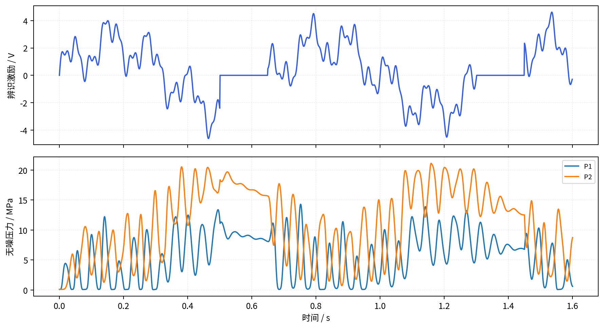
图2-1 辨识输入与双腔压力响应；激励由输入公式生成，响应由四阶ODE积分

位移观测叠加标准差20 μm的高斯噪声，压力观测叠加20 kPa噪声；每通道以0.8%概率加入脉冲污染。噪声参数是公开仿真假设，不是某型号传感器的校准结论。观测通道为位移、无杆腔压力和有杆腔压力；没有将油液模量真值作为观测特征输入优化器。

## 2.1.1 因果级联滤波与相位处理

级联第一层为长度5的因果滑动中值，使用当前及过去样本抑制孤立脉冲。第二层为截止120 Hz的二阶Butterworth低通。程序调用scipy.signal.butter设计SOS系数，但滤波计算由自主编写的直接II型转置递推执行；常值初态采用稳态初始化，避免把兆帕级压力错误地从零启动。

```text
median_k = median(y[max(0,k-4):k+1]);  filtered = SOS_Butterworth(median)
```

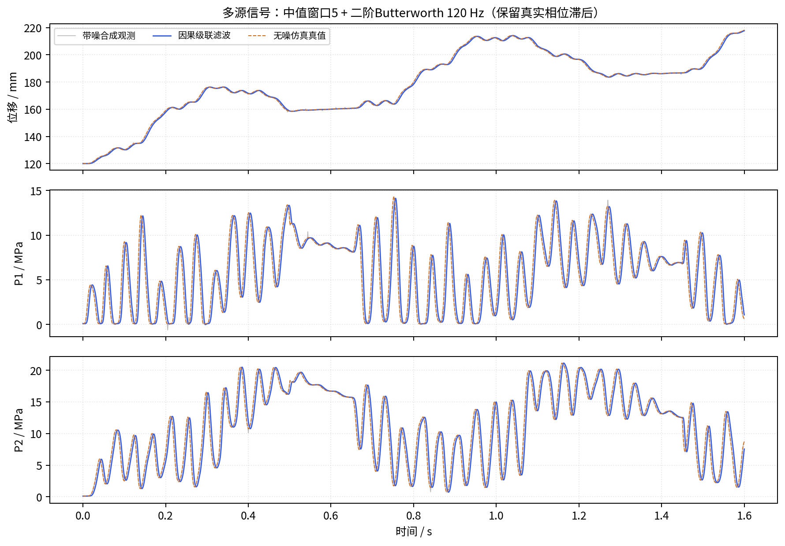
图2-2 多源级联清洗；滤波曲线保留因果时延，不使用前后向零相位滤波

因果滤波必然改变相位。若把延迟后的观测直接与未滤波模拟量比较，优化器可能将相位误差误认为模量偏差。因此目标函数对每一个候选模型的输出施加同一条中值与Butterworth链，再与滤波观测比较。该处理用于离线辨识；三控制器的主对比使用理想完整状态反馈，没有暗中让某一组读取更干净的传感器。

降噪指标也区分两种参照：原始噪声相对未滤波真值计算；滤后残差相对“真值经过同一因果滤波”的输出计算。这一口径用于评估噪声抑制，不等价于宣称滤后信号与当前真实状态完全无相位差。

## 2.2 四阶状态空间与非线性环节

状态定义为y=[x,v,P1,P2]，内部全部采用SI单位。无杆腔和有杆腔面积分别为0.002和0.001 m²，质量500 kg，物理行程0.30 m，供油21 MPa、回油0.10 MPa。面积、容积和阀开度是本综合实验公开的教学配置，并非将仓库各章节不同工作点拼成一个所谓已辨识设备。

```text
V1 = V01 + A1*x;  V2 = V02 + A2*(L-x)
xdot=v
m*vdot=A1*(P1-Pr)-A2*(P2-Pr)-Ff(v)-Fload
```

力平衡使用相对回油/环境基准的压力，避免非对称面积在双腔同为回油压力时产生无依据的净驱动力。摩擦由平滑Stribeck项、tanh方向函数与粘性项构成，满足正反方向的奇对称性。该连续滑动近似能表达低速摩擦下降，但不包含集合值静摩擦的严格粘住/释放事件，不将近零速度小幅移动称作真实静摩擦锁死。

```text
w>=0: Q1=K*w*R(Ps-P1), Q2=-K*w*R(P2-Pr)
w<0:  Q1=K*w*R(P1-Pr), Q2=-K*w*R(Ps-P2)
K=Cd*b*xvmax/10*sqrt(2/rho); R(dP)=dP/(dP^2+1000^2)^(1/4)
```

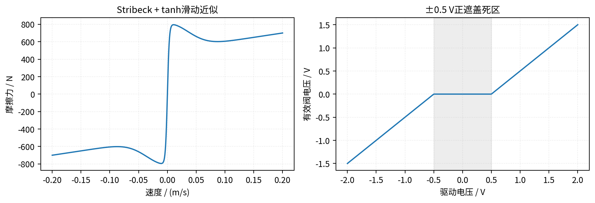
图2-3 编码的摩擦与正遮盖死区特性（公式特性图，不是测量数据）

死区映射w=sign(u)max(|u|-δ,0)，δ=0.5 V。孔口先按w的正负选择进回油拓扑，再使用有向压差；零压差附近以1 kPa尺度光滑化，以免平方根导数奇异或回流方向错误。有效电压w与物理电压u的单位均为V，但二者不能混淆。

## 2.2.1 连续性、低压柔度与数值求解

```text
P1dot = beta1/V1 * (Q1-A1*v-Ct*(P1-P2))
P2dot = beta2/V2 * (Q2+A2*v+Ct*(P1-P2))
```

内泄漏在无杆腔和有杆腔连续性方程中符号相反；当P1>P2时，增加Ct应降低P1变化率、提高P2变化率。模型还显式计入从油箱补油的单向流量。所有状态来自微分方程积分，不把压力裁剪到21 MPa，也不通过位置截断来伪造停止。

```text
1/beta_mix(P) = (1-alpha)/beta_oil + alpha/P,  alpha=0.001
beta_effective(P,t) = fault_ratio(t) * beta_mix(P)
```

低压区采用固定0.1%局部含气量的Wood柔度近似。P趋近真空时有效模量随P降低，缓和非物理负压穿越；这不是完整两相气穴模型。辨识的beta是油液高压标称模量参数，低压变化由公开的混合柔度公式确定。极限工况在0.50 s将fault_ratio从1切换为0.5，使同一状态下连续性方程的有效模量恰好整体减半，而非仅将油相参数减半。

表2-1 统一物理参数、量纲与离散时序

| 参数 | 公开数值及单位 | 实现约定 |
|---|---|---|
| A1 / A2 | 0.002 / 0.001 m² | 面积比2:1 |
| 质量 / 行程 | 500 kg / 0.30 m | 各策略共用 |
| V01 / V02 | 0.00015 / 0.00015 m³ | 单腔附加容积150 mL |
| Ps / Pr | 21 / 0.10 MPa | 供油/回油基准 |
| beta / Ct真值 | 1.10 GPa / 2.40e-12 | Ct单位m³/(s·Pa) |
| Fs / Fc / vs | 800 N / 500 N / 0.05 m/s | 平滑Stribeck |
| sigma / gamma | 1000 N·s/m / 300 s/m | 粘性/方向平滑 |
| Cd / b / xvmax | 0.62 / 0.02 m / 0.001 m | 阀输入±10 V |
| 死区 / 气体分数 | ±0.5 V / 0.001 | 局部Wood柔度 |
| 控制周期 / 子步 | 1 ms / 1/64 ms | 不裁剪积分状态 |

每个1 ms周期内作64个RK4子步，保存双腔和位移节点极值。独立复核以相同保存电压驱动Radau积分器，允许比较全轨迹误差而不是只比较末点。节点极值不能构成严格连续时间安全证明，后文峰压同时给出独立积分复算。

## 2.3 无量纲差分进化参数反演

参数跨越1e9 Pa和1e-12 m³/(s·Pa)两个量级，直接在原尺度扰动会严重偏置搜索。采用两个[0,1]无量纲决策变量：模量在0.5—1.8 GPa内线性映射，Ct在10^-12.5—10^-11内按对数映射。DE按差分变异、交叉和择优保留迭代，不让较大量纲自然主导目标函数[5]。

```text
beta = (0.5+1.3*theta1)*1e9
Ct = 10^(-12.5+1.5*theta2)
J = mean( ((Filter(y_sim)-Filter(y_obs))/scale)^2 )
scale = [0.005 m, 2e6 Pa, 2e6 Pa]
```

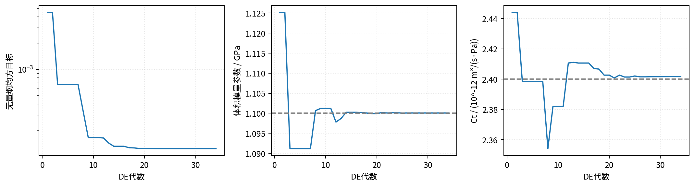
图2-4 无量纲目标下降及参数轨迹；灰色虚线为仅用于验证的合成真值

本次学号种子0795得到beta=1.100058 GPa，Ct=2.401660×10^-12 m³/(s·Pa)。相对真值的偏差分别为0.0053%与0.0692%。DE执行34代，程序记录的终止状态为“Optimization terminated successfully.”，未把预算用尽和满足收敛条件混为一谈。

目标函数跳过开头20个样本以减轻初始化效应；候选仿真输出与观测使用相同滤波链。虽然真值已知，但优化目标只比较预测与带噪观测；模型误差、测量偏置和未知初态在实物系统中会降低辨识精度，不能把本合成试验的极小偏差当作现场可达保证。

## 2.3.1 独立激励验证与辨识可信度

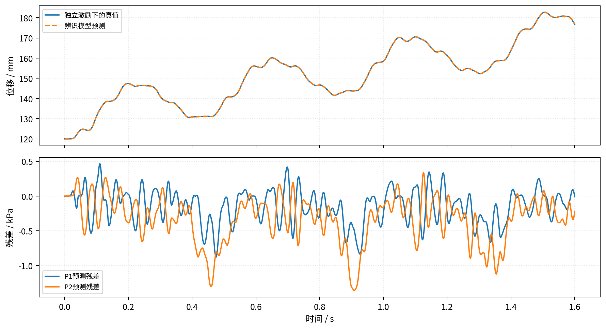
图2-5 未参与DE目标函数的验证激励：位移预测与双腔压力残差

表2-2 辨识模型的留出激励验证

| 指标 | 本次结果 | 参照 |
|---|---|---|
| 验证位移RMSE | 0.004200 mm | 独立无噪真值 |
| 验证速度RMSE | 0.009696 mm/s | 独立无噪真值 |
| 验证P1 RMSE | 0.285 kPa | 独立无噪真值 |
| 验证P2 RMSE | 0.470 kPa | 独立无噪真值 |

验证时固定DE得到的参数，不再根据验证残差回调。低频闭口信息和高频压力响应使模量与泄漏具有不同的可辨识效应；但本设计未对所有工况证明全局唯一可辨识性，也未开展毕业设计要求的多种群统计。小残差只说明当前模型族在当前激励包络中能够恢复所设参数。

后续控制器统一使用这一辨识结果，真实被控对象继续使用独立真值。极限工况仅改变实际对象的外载和有效模量倍率，控制器模型不读取真实故障倍率；这种设置避免了用“真实参数已知”的控制器冒充参数失配鲁棒性。

# 第3章 基于机理补偿与物理约束的确定性控制策略

## 3.1 增量式PID与积分饱和

```text
e[k]=r[k]-x[k]
df[k]=alpha*df[k-1]+(1-alpha)*Kd*(e[k]-e[k-1])/Ts
Delta u=Kp*(e[k]-e[k-1])+Ki*Ts*e[k]+df[k]-df[k-1]
u[k]=clip(u[k-1]+Delta u,-10,+10)
```

误差内部采用m，因而Kp、Ki、Kd必须按SI误差整定，不能直接移植以cm或mm为输入的数值。主实验固定Kp=250 V/m、Ki=150 V/(m·s)、Kd=1 V·s/m，微分滤波系数0.85。增量式实现把实际限幅输出存回u[k-1]，不保留额外的无限制输出记忆。它减少饱和期间无效积分积累，但不能自动解决液压对象的相位裕度、死区或压力风险[3]。

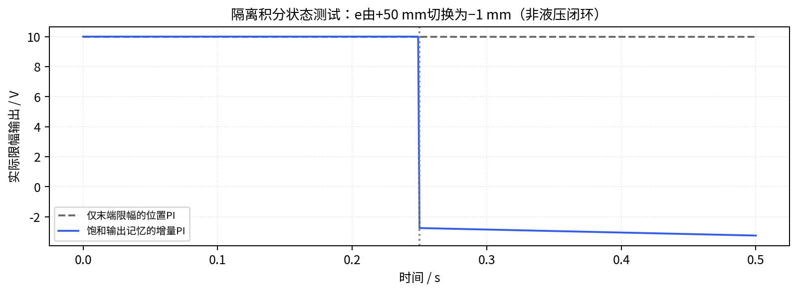
图3-1 隔离积分状态的PI台架测试：预设误差切换，不属于液压闭环性能曲线

图3-1仅用于核验控制器状态：统一使用Kp=250、Ki=2000、Kd=0，误差由+50 mm切换为−1 mm。只在末端限幅的位置PI仍保留累计积分，反向后可持续输出同方向电压；增量PI的饱和输出记忆能立即退出该状态。这里主动关闭微分以隔离积分机制，不把这组参数或测试误差混入三策略主实验。

主变负载试验未出现实际电压饱和，故不能说其PID误差已经证明了windup；该误差主要反映固定反馈增益、轨迹变化和扰动耦合。积分饱和的机制解释以隔离测试和状态方程为依据，和主实验结论分别陈述。

## 3.2 二自由度逆动力学与压差补偿

模型辅助控制把参考轨迹的解析位置、速度、加速度、跃度与当前完整状态分别用于前馈和反馈。外环构造期望加速度，逆动力学将其转换为期望液压力；内环对实际液压力误差进行反馈，并由连续性方程反解阀开口。该结构参考仓库第六章的G/H反演，但本工程去掉了额外阀动态以满足统一四阶状态要求。

```text
a_des = a_ref + 70*(v_ref-v) + 4000*(x_ref-x) + 2000*integral(e)
F_des = m*a_des + Ff(v_ref) + Fhat_load
Fh = A1*(P1-Pr)-A2*(P2-Pr)
Fdot_des = m*j_ref + Ff_prime(v_ref)*a_ref + 80*(F_des-Fh)
```

将双腔连续性方程组合为Fh_dot=G(y,w方向)*w+H(y)，其中H包含运动流量、泄漏及补油项，G包含当前阀口压差与有效模量。求w=(Fdot_des-H)/G后施加开口限制，再通过分段死区逆得到u。相同目标流量在重载压差变小时需要更大开口，因此实时压力决定的G起到流量增益线性化作用。

```text
w = clip((Fdot_des-H)/G,-9.5,+9.5)
u = 0 if |w|<1e-7 else w+sign(w)*0.5
```

未知负载不直接读取仿真事件标签。程序用当前压力、过去速度和质量估计外载：先对速度作一阶差分，再计算Fh−Ff−m*a_est，经过8 ms时间常数低通并限制估计幅值。MPC使用同一结构的独立估计器。该估计有滞后和离散误差，且在实机噪声下需要进一步设计；本实验的理想状态反馈使这一过程较为有利。

结果代表“逆动力学、压力增益调度、误差反馈和因果扰动估计”的组合，未做控制器消融，不能将全部精度提升单独归因于某一补偿项。若局部逆增益非正，代码显式结束该试验并记录原因，不用零电压伪装成安全解。

## 3.3 仿射LTV预测与增量决策

MPC在每个控制周期基于当前状态和上一开口建立局部模型，并沿上一候选计划进行非线性滚动与重新线性化。采用3轮序列QP，预测时域N=30、采样1 ms；在线更新局部雅可比而非冻结整个试验的工作点。状态缩放为z=[x_mm,v_m/s,P1_MPa,P2_MPa]，改善矩阵条件数[4,6]。

```text
zdot = A_c*z + B_c*w + c_c
[z_next] = A_d*z + B_d*w + c_d
[A_d,B_d,c_d] from expm(augmented continuous matrix * Ts)
```

仿射偏置c不能省略。孔口、摩擦和容积均具有非线性，仅用A*z+B*w一般不能还原当前工作点的真实导数。对当前局部连续仿射模型采用增广矩阵指数进行零阶保持离散化；矩阵指数是局部模型的精确离散化，不等于对完整非线性对象的精确预测。

```text
W = 1*w_previous + S*DeltaW,  S=lower_triangular(ones)
Z = F*z_current + G*W + b
Z = Z_free + Phi*DeltaW,  Phi=G*S
```

位置、速度跟踪权重分别为100和100，有效电压增量权重0.5，并附加0.001的开口幅值惩罚。目标函数统一除以100只改变数值尺度，不改变同一个QP的最优解。每轮限制新计划相对线性化计划的开口变化不超过2 V，限制局部模型在不合理范围内被使用。

```text
J = (Z-Z_ref)^T*Qbar*(Z-Z_ref) + 0.5*||DeltaW||² + 0.001*||W||²
H = 2*(Phi^T*Qbar*Phi + R + 0.001*S^T*S)
q = 2*Phi^T*Qbar*(Z_free-Z_ref) + 0.002*S^T*1*w_previous
```

执行流程为感知→扰动估计→滚动线性化→求解3个局部QP→施加第一步→下一周期重置。未来参考使用同一解析S轨迹，不给MPC额外的真实负载先验或故障倍率。

## 3.3.1 双腔压力约束与求解验收

压力在缩放状态中的单位为MPa。令C_P为从各预测步选择P1、P2的行选择矩阵；物理红线为21 MPa，优化上界内缩至19.5 MPa，以保留1.5 MPa非线性预测与参数偏差余量。下面的不等式直接进入OSQP的A、l、u矩阵，不是事后在曲线上画一条红线。

```text
C_P*(Z_free+Phi*DeltaW) <= 19.5*1
A_pressure = C_P*Phi
b_pressure = 19.5*1 - C_P*Z_free
```

表3-1 约束、单位与实际适用范围

| 约束对象 | 优化器中的表达 | 执行层意义 |
|---|---|---|
| 电压幅值 | -9.5 <= w_prev+S*DeltaW <= 9.5 | 经死区逆后|u|<=10 V |
| 开口增量 | |Delta w|<=1 V | 跨死区时|Delta u|<=2 V |
| 局部信赖范围 | |W-W_nominal|<=2 V | 减轻局部线性化外推 |
| 两腔压力上界 | C_P*Phi*DeltaW<=b_pressure | 预测上限19.5 MPa |
| 低压/气穴 | 不加入QP下限约束 | 由物理模型和记录另行评估 |

本实现只将两腔最高压力作为QP硬约束。低压柔度和补油由物理方程描述，但最低压力不被优化器保证；制动结果中的近真空压力必须另行披露，不能把“未超21 MPa”等同于同时解决了抗气蚀。相比在不适用的线性模型上强加下限而误报全域可行，这一区分更符合本阶段实际代码。

求解后独立计算最大原始约束残差，要求不超过0.002（相应行的量纲）。允许迭代上限时仅在更严格的0.0002可行性残差下接收近似解，并记录状态；不能把可行迭代点写成已证明最优。若无可行候选则结束试验并保留失败记录。本次主比较与限压制动的近似接收次数以原始指标表为准。

约束施加于局部预测模型，实际对象包含非线性和失配，因此不构成鲁棒前向不变性证明。验证将检查实际子步峰压和独立Radau轨迹，而不是用QP预测峰值替代真实仿真峰值。

# 第4章 统一极限工况对比与安全评估

## 4.1 统一试验协议与评价定义

主试验从x=40 mm、v=0、双腔0.10 MPa开始，在0.8 s完成80 mm位移，随后保持至1.2 s。标称工况用于检查基本跟踪；极限工况在0.50 s同时施加未知5000 N阶跃外载和有效模量整体0.5倍率。三策略使用相同真值参数、初态、参考、时间网格与积分子步，只有控制算法不同。

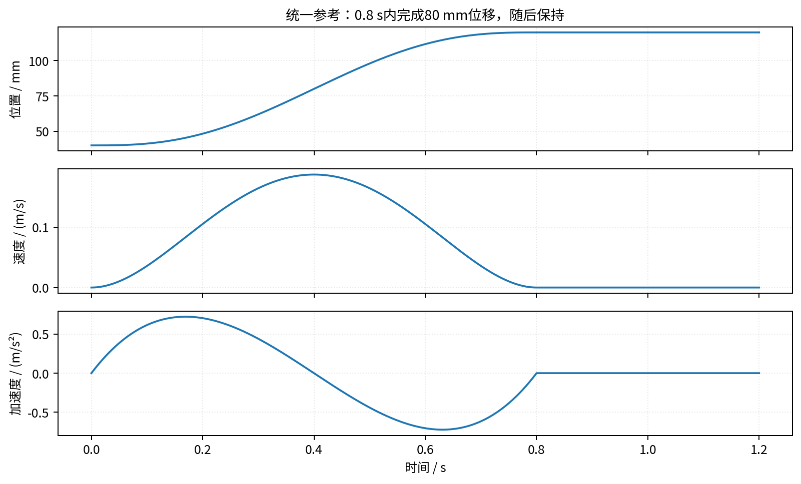
图4-1 统一参考位置、速度与加速度；没有向某一控制器单独提供更柔和轨迹

```text
RMSE = sqrt(mean(e[k]^2)) over 0...1.2 s
MAE_dist = max |e[k]| for t in [0.50,0.65] s
TV = sum |u[k]-u[k-1]|
Pmax = max over both chambers and saved integration substeps
```

任务书的MAE在此按“最大绝对误差”解释，不是通常统计学中同缩写的平均绝对误差。全程RMSE包含同一运动段和保持段；表格同时列全程最大误差与末端误差，以免只选择有利时间窗口。对非零初速度制动试验，TV从实际巡航前一电压开始累计，而不是虚构从0 V开始的跳变。

三策略的状态反馈均为无噪完整状态，以隔离控制算法与参数失配的作用。带噪信号清洗在第2章单独完成，不据此声称已经验证了含传感噪声的实机闭环。主比较不含SAC，相关学习试验按本次范围明确暂缓。

## 4.2 标称工况的跟踪性能

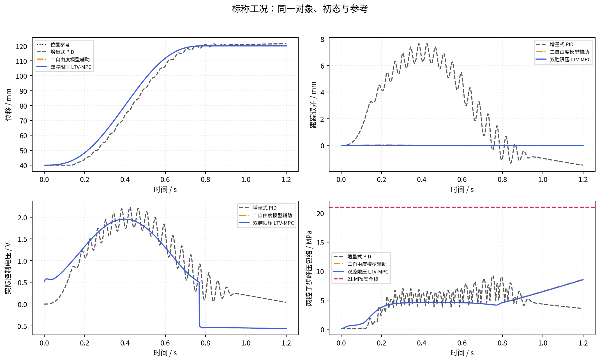
图4-2 标称工况：位移、误差、实际电压和双腔子步峰压包络

表4-1 标称条件下的真实记录指标

| 控制器 | 全程RMSE/mm | 最大误差/mm | TV/V |
|---|---|---|---|
| 增量PID | 3.8326 | 7.6386 | 19.41 |
| 模型辅助 | 0.0159 | 0.0322 | 4.54 |
| LTV-MPC | <0.001 | <0.001 | 4.54 |

固定反馈PID需要先积累偏差才能补足巡航电压，因此存在较明显的动态滞后。模型辅助控制依靠参考导数和当前压力提前给出建压流量，减轻反馈纠偏负担；MPC利用未来参考和机理预测获得更小的理想模型误差。这里的差异同时包含模型信息使用方式和控制器结构，不能作为所有PID整定方案的理论上界。

理想、无噪、同模型仿真中的极小误差可能低于真实传感器分辨率。表中仅保留有限小数，不能将数值零附近的MPC误差当作纳米级实际定位精度。当前结果的可信范围需结合第5章给出的积分复核和未建模因素判断。

## 4.3 5000 N与刚度减半的复合扰动

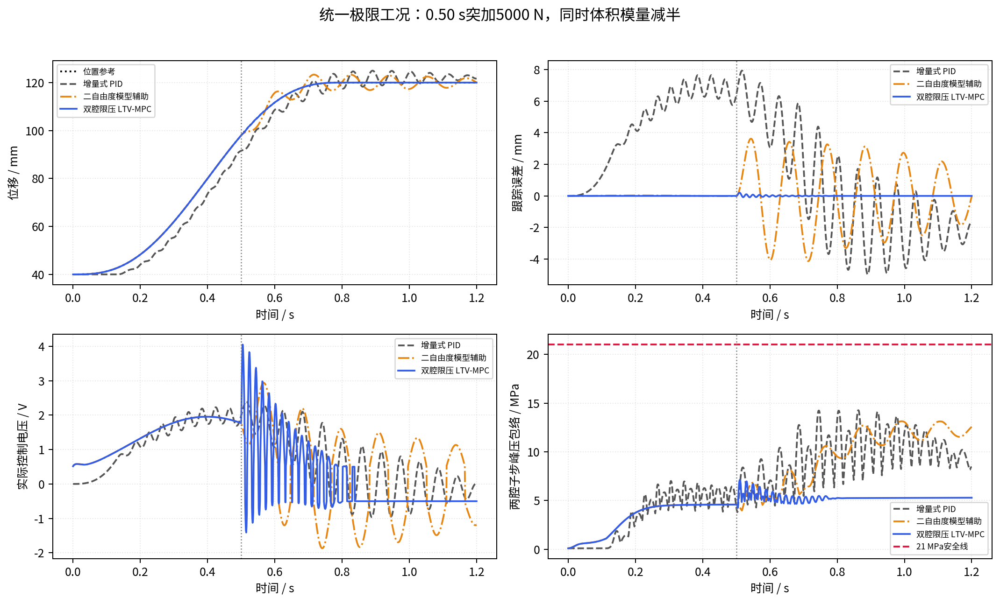
图4-3 统一极限工况：0.50 s处外力与有效模量同时变化；每条曲线为自身闭环积分

表4-2 主极限工况的统一比较

| 控制器 | RMSE/mm | 扰动MAE/mm | 峰压/MPa |
|---|---|---|---|
| 增量PID | 4.2755 | 7.9222 | 14.257 |
| 模型辅助 | 1.6966 | 4.0536 | 13.131 |
| LTV-MPC | 0.0223 | 0.2049 | 7.106 |

三组均完成1201个采样点。增量PID、模型辅助与MPC全程RMSE分别为4.2755、1.6966、0.0223 mm。该结果说明当前整定和模型条件下，机理前馈与滚动预测减轻了复合扰动造成的误差；并非脱离工作点的通用算法排名。

突加外载首先改变加速度，压力状态本身不发生瞬时数值跳跃。控制器的负载估计需要通过后续状态变化获得信息，故不能在事件发生前“预知”5000 N。模量倍率只传给实际对象，控制器保持辨识得到的标称模型；MPC仍通过每周期状态重置和扰动估计更新应对失配。

## 4.3.1 扰动瞬态与输入平滑性

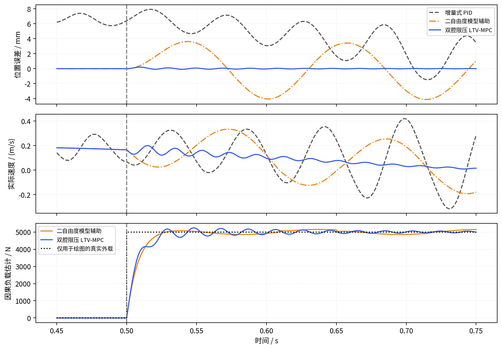
图4-4 扰动窗口的位置误差、速度与因果负载估计；真实外力虚线只用于事后绘图

较小位置误差并不意味着更小的控制代价。TV统计的是实际驱动电压的绝对增量之和，包含死区逆映射跨零时的跳变；不能把有效开口w的TV误当成驱动器u的TV。MPC虽然约束每步开口变化，长时程微小调整仍可能使累计TV增加。

表4-3 精度与执行器动作代价

| 控制器 | TV/V | 末端误差/mm | 饱和占比 |
|---|---|---|---|
| 增量PID | 44.54 | -1.64177 | 0.00% |
| 模型辅助 | 40.46 | -0.02278 | 0.00% |
| LTV-MPC | 87.26 | 0.00000 | 0.00% |

本次MPC取得更小的误差，但累计电压总变差并非三者最小。这是多目标控制的实际权衡，不能用图像的线条粗细掩盖。增量权重、死区处理或执行器速率限制的进一步优化属于后续研究；课程设计不为追求某一参考图数值而对输出作事后平滑。

## 4.4 制动工况中的主动限压验证

主极限工况的全部峰压均低于21 MPa，压力约束未必活跃，仅凭该结果无法证明限压的作用。另设非零初速度急停：初始位置80 mm、速度0.7 m/s，两腔压力和前一电压由恒速平衡方程求得，随后位置参考保持80 mm、目标速度为0。各组共用该非静止初态，不通过修改某一组参数制造过压。

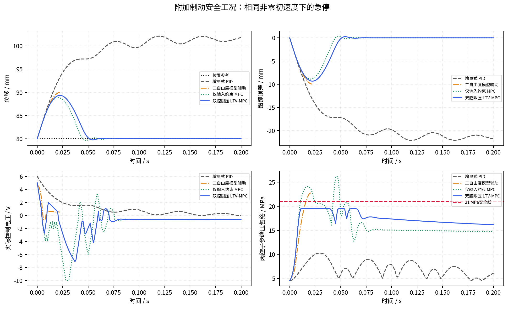
图4-5 附加急停试验；模型辅助失败后停止记录，未补齐理想后半程

表4-4 制动安全性及轨迹完整性

| 控制器 | 最高压力/MPa | 是否完成 | 21MPa上限 |
|---|---|---|---|
| 增量PID | 10.288 | 是 | 通过 |
| 模型辅助 | 22.798 | 否 | 超限 |
| 仅输入MPC | 26.221 | 是 | 超限 |
| 双腔限压MPC | 19.536 | 是 | 通过 |

同一初态、同一目标及同一MPC权重下，取消双腔上界后峰压为26.221 MPa；加入上界后为19.536 MPa。限压组允许较大的停止距离/位置超调来分配制动过程，体现安全约束与快速定位之间的取舍。不同初态下的这一附加试验不能与主工况RMSE混排。

## 4.4.1 压力边界、求解耗时与未通过项

急停时仅输入约束MPC虽然最终回到参考位置，但已经突破21 MPa，说明低末端误差不能代表安全。模型辅助组在局部逆增益非正时主动结束，其记录不是完整时域；报告不将该组短记录的RMSE与完整试验作无条件排名。限压MPC实际峰压可能略高于19.5 MPa预测界，但仍低于21 MPa物理线，差值反映局部模型与非线性对象之间的偏差。

同时必须披露低压风险：限压MPC制动中的最低绝对压力约0.000988 MPa，已处于严重低压区域。本程序未把最低压力加入QP约束，也未实现完整气穴体积分数动力学；因此只能得出“本次轨迹上限防过压有效”，不能声称同时保障抗气蚀或全部工况的本质安全。

表4-5 当前CPU的完整控制计算耗时

| 控制器 | 主工况均值/ms | 95分位/ms | 迭代上限近似步数 |
|---|---|---|---|
| 增量PID | 0.0047 | 0.0069 | 0 |
| 模型辅助 | 0.0192 | 0.0315 | 0 |
| LTV-MPC | 14.5361 | 18.3043 | 0 |

耗时使用perf_counter记录完整控制调用，包含模型线性化、矩阵构造、序列QP和求解检查，不仅是OSQP报告的底层solve_time。首次调用可能包含JIT初始化，CSV保留该真实开销，均值与分位数因此可能受到不同影响。本机MPC未达到1 ms完整周期实时要求，Ts=1 ms只是仿真零阶保持周期，不能写成已满足嵌入式硬实时。

没有使用控制输出限幅或图形裁剪替代QP压力约束；没有在求解失败后默默保持零电压。近似求解、不可行和物理模型失效有独立记录。以上边界是对当前实现的具体限定，不取消已通过的主工况精度比较与附加上限压力验证。

# 第5章 总结

## 5.1 主要结论与方法适用性

第一，建立了包含双腔连续性、非对称受力、Stribeck摩擦、正遮盖死区及低压柔度的四阶对象。以种子0795生成合成观测，经过自主中值与SOS递推清洗后，在无量纲DE空间恢复模量和Ct，参数相对误差为0.0053%和0.0692%。独立激励验证支持其在本次模型族和数据包络中的准确性。

第二，统一复合扰动下，增量PID、模型辅助与LTV-MPC的全程RMSE依次为4.2755、1.6966和0.0223 mm。机理模型既是离线数据生成与参数反演的基础，也是在线逆补偿和预测规划的计算依据；不应把机理建模理解为只服务某一种控制器的前置工作。

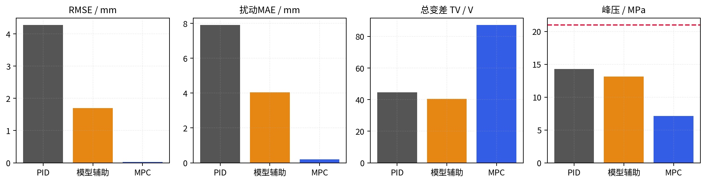
图5-1 精度、扰动误差、输入TV与双腔峰压的多指标比较

第三，主动压力约束的价值通过单独急停试验体现：仅输入约束MPC的峰压26.221 MPa，双腔上限约束组为19.536 MPa。该结果不等于低压安全或鲁棒不变性证明。MPC的更小误差同时伴随较高计算代价和一定输入TV代价，没有形成所有指标均占优的结论。

## 5.2 局限、可复现性与后续工作

本设计的证据边界包括：辨识数据来自同结构合成对象；闭环状态反馈理想无噪；阀芯电磁/机械动态和完整管路分布未纳入；局部含气柔度不能代替完整多相气穴模型；未知外载估计使用速度差分，在实机中需与传感器噪声、滤波滞后共同设计。因此，报告中的亚毫米甚至更小数值误差是当前数值试验结果，不是实机精度保证。

压力QP只约束两腔上限，低压风险在急停工况中真实存在。后续可增加压力下限、气穴状态和更可靠的可行性恢复策略，但不能简单把线性预测中的下限条件等同于真实对象连续安全。还应通过模型误差包络、约束收紧或鲁棒MPC建立可验证的失配安全边界。

实时部署需要同时压缩状态预测、雅可比和QP开销。可在保持相同数学问题和验收条件下预分配矩阵、复用稀疏结构、减少不必要的重复建模，并在目标处理器重新测量整周期时间。当前Python CPU结果不足以支撑1 ms硬实时声称。

表5-1 一键复现与证据定位

| 复现项目 | 入口/文件 | 说明 |
|---|---|---|
| 完整流程 | run_course_design.py --seed 0795 | 辨识、仿真、独立验证、图表和报告 |
| 单元检查 | python -m unittest -v | 15项公式与接口检查 |
| 原始数据 | results/*_traces.csv | 各控制器自己的状态与实际u |
| QP证据 | results/*_matrices_*.npz | 预测、目标、约束和解 |
| 来源与指纹 | repository_sources.json / MANIFEST.json | 固定Git提交及SHA256 |

第八章按当前指令不纳入本阶段，不提供SAC或HOCBF试验。若后续恢复该部分，应在相同对象、参考、初态、故障和评价口径上增加算法，再补回原任务书第4章对应内容。只有重新生成统一对比结果，才适合扩展最终全量结论。

本次独立验证共检查50项数据、时钟、矩阵和轨迹条件，原始结果保存于validation.json。种子0795、真实数据来源、失败试验、未通过实时性以及低压边界在报告中均显式披露，便于评阅者从公式、代码、数据一直追溯至图表。

# 参考文献

[1] MERRITT H E. Hydraulic control systems[M]. New York: John Wiley & Sons, 1967.
[2] WATTON J. Fundamentals of fluid power control[M]. Cambridge: Cambridge University Press, 2009.
[3] ASTROM K J, HAGGLUND T. Advanced PID control[M]. Research Triangle Park: ISA, 2006.
[4] RAWLINGS J B, MAYNE D Q, DIEHL M. Model predictive control: theory, computation, and design[M]. 2nd ed. Madison: Nob Hill Publishing, 2017.
[5] STORN R, PRICE K. Differential evolution: a simple and efficient heuristic for global optimization over continuous spaces[J]. Journal of Global Optimization, 1997, 11: 341-359. DOI:10.1023/A:1008202821328.
[6] STELLATO B, BANJAC G, GOULART P, et al. OSQP: an operator splitting solver for quadratic programs[J]. Mathematical Programming Computation, 2020, 12: 637-672. DOI:10.1007/s12532-020-00179-2.
[7] VIRTANEN P, GOMMERS R, OLIPHANT T E, et al. SciPy 1.0: fundamental algorithms for scientific computing in Python[J]. Nature Methods, 2020, 17: 261-272. DOI:10.1038/s41592-019-0686-2.
[8] 崔岩. 智能流体传动与控制：课程综合训练与本科毕业设计任务书[Z]. 2026.
[9] cran506. 智能流体传动与控制课堂编程[CP/OL]. GitHub仓库a，提交bae77ed1fbfb6d9711a50e2e7a9bad437945e5bb[2026-11-18]. https://github.com/cran506/a.
