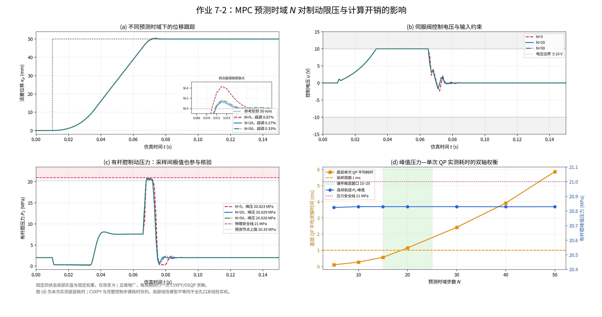

# 第七章习题 7-2：预测时域对制动限压与计算开销的影响

## 1. 实验任务与课件对应

本报告依据本次上传的《第七章：基于模型预测的约束控制与滚动优化》课件，完成 50 mm 定位、1 ms 采样和压力安全约束下的预测时域比较。于 $t=0.01\,\mathrm{s}$ 输入 $r=50\,\mathrm{mm}$ 阶跃，仿真到 0.15 s；比较 $N=5,20,50$，并扫描 $N=[5,10,15,20,30,40,50]$。

| 课件页码 | 理论内容 | 本作业实现 |
| --- | --- | --- |
| 4、10 | 输入、变化率与压力约束 | 电压、增量和两腔压力线性不等式；变化率采用第 10 页硬界形式 |
| 5 | 预测、优化、首步执行、反馈重置 | 每 1 ms 采集四状态、求解一次 QP、仅施加首个电压 |
| 7 | Kq、Kc 流量雅可比 | 固定工作点的四状态局部流量—压力模型 |
| 8 | 五维增广状态与离散模型 | 四物理状态加上一周期电压；精确 ZOH 离散 |
| 9–11 | F、Phi、H 与参数化 QP | CVXPY 凝聚形式、OSQP 热启动；附矩阵与等价性测试 |
| 15 | 时域、制动距离和实时性研讨 | 七组性能表、四联图、制动量级分析、实测截止时间讨论 |

**控制变量原则：全部时域使用相同模型、初态、目标权重、约束和求解器设置，只改变 N。** 没有按 N 调整终端代价，也没有失败后的 PID、网格搜索或多轮 SQP。QP 不可行时程序明确报错，而不把其他策略记为 QP 成功。

## 2. 四状态局部灰盒模型

### 2.1 状态、单位和工作点

物理状态为 $z=[x_p,v_p,P_1,P_2]^\mathsf T$，程序单位依次为 mm、m/s、MPa、MPa，压力采用表压。控制量 $u$ 为零偏置等效模型控制电压，教学标称值设为 $u_0=0$，假设可用范围为 ±10 V。若实机标称电压不为零，实际约束应改写为 $|u_0+\delta u|\le10$ V。工作点取 $P_{10}=5\,\mathrm{MPa}$、$P_{20}=2\,\mathrm{MPa}$、$v_0=0$。

课件未给出唯一完整参数表，以下为公开的教学参数，不是实机辨识结果。

| 参数 | 数值 | 含义 |
| --- | ---: | --- |
| $m$ | 71.4286 kg | 等效移动质量 |
| $A_1,A_2$ | 0.001、0.0005 m² | 两腔有效面积 |
| $\sigma$ | 714.2857 N·s/m | 黏性阻尼 |
| $\beta$ | $10^9$ Pa | 有效体积模量 |
| $V_1,V_2$ | $10^{-4}$、$2.5\times10^{-5}$ m³ | 冻结工作点容积 |
| $K_{q1},K_{q2}$ | $1.5\times10^{-4}$、$5\times10^{-5}$ m³/(s·V) | 电压—流量增益 |
| $K_{c1},K_{c2}$ | $10^{-10}$、$1.25\times10^{-11}$ m³/(s·Pa) | 流量—压力系数 |
| $F_0$ | 4000 N | 恒定外部预载荷 |

初态的力平衡需要显式保留预载荷：

$$
F_0=A_1P_{10}-A_2P_{20}=4000\ \mathrm N.
$$

### 2.2 力学与连续方程

令 $\Delta P_i=P_i-P_{i0}$。局部净流量取

$$
\Delta Q_1=K_{q1}u-K_{c1}\Delta P_1,\qquad
\Delta Q_2=K_{q2}u+K_{c2}\Delta P_2,
$$

其中 $Q_2$ 正方向为有杆腔流出。结合受力与可压缩连续方程：

$$
\dot x_p=v_p,\qquad m\dot v_p=A_1P_1-A_2P_2-\sigma v_p-F_0,
$$

$$
\Delta\dot P_1=\frac{\beta}{V_1}(\Delta Q_1-A_1v_p),\qquad
\Delta\dot P_2=\frac{\beta}{V_2}(A_2v_p-\Delta Q_2).
$$

换算成程序单位后为

$$
\dot x_p=1000v_p,\qquad
\dot v_p=-10v_p+14\Delta P_1-7\Delta P_2,
$$

$$
\Delta\dot P_1=1500u-10000v_p-1000\Delta P_1,
$$

$$
\Delta\dot P_2=-2000u+20000v_p-500\Delta P_2.
$$

这是课件 LTV 框架的**固定工作点 LTI 特例**。本实验冻结 Kq、Kc 和容积来隔离时域效应，未声称捕获全行程阀口换向、死区、摩擦、含气率变化及容积变化。常数 $K_c>0$ 是工作点附近的流量—压力雅可比或等效阻尼；$u=0$ 时压力回归基线是局部模型的平衡恢复，不能解释为真实零开度闭中位阀自动卸压，也未增设课件之外的调压回路。该局部净流量模型并未辨识真实阀芯的标称开度或结构。

### 2.3 离散化与五维增广

课件第 8 页展示 Euler 近似。本实验采用同一连续模型的精确零阶保持离散：

$$
A_d=e^{A_cT_s},\qquad B_d=\int_0^{T_s}e^{A_c\tau}B_c\,d\tau,\qquad
c_d=z_0-A_dz_0.
$$

压力系数含 $1000\,\mathrm{s}^{-1}$ 模态，1 ms Euler 步长会带来较大的压力动态误差；ZOH 保留恒定电压期间的精确响应。每步施加的电压确实保持 1 ms，因而预测与连续对象的采样节点一致。

以 $\xi_k=[z_k^\mathsf T,u_{k-1}]^\mathsf T\in\mathbb R^5$、$\Delta u_k=u_k-u_{k-1}$ 得

$$
\xi_{k+1}=\begin{bmatrix}A_d&B_d\\0&1\end{bmatrix}\xi_k+
\begin{bmatrix}B_d\\1\end{bmatrix}\Delta u_k+
\begin{bmatrix}c_d\\0\end{bmatrix}.
$$

因此 $A_{\mathrm{aug}}$ 为 $5\times5$、$B_{\mathrm{aug}}$ 为 $5\times1$。本次模型的 Jacobian 是常数；如扩展到 LTV，需随工作点更新矩阵并重新验证，不能沿用本次性能结论。

## 3. 预测、目标函数与硬约束

堆叠未来 $N$ 步的五维增广状态：

$$
\Xi=F\xi_k+\Phi\Delta U+b,
$$

其中 $F\in\mathbb R^{5N\times5}$、$\Phi\in\mathbb R^{5N\times N}$，$\Delta U\in\mathbb R^N$。只选择位置、速度行参与跟踪，所有 N 共用目标

$$
J=\sum_{i=1}^{N}\left[(x_{k+i}-r)^2+2v_{k+i}^2\right]
+0.001\sum_{i=0}^{N-1}(\Delta u_{k+i})^2.
$$

即 $q_x=1,q_v=2,W=0.001$，与整体乘以 100 后的 $100,200,0.1$ 有相同最优解。凝聚后

$$
H=2(\Phi_y^\mathsf TQ\Phi_y+WI),\quad
g=2\Phi_y^\mathsf TQ(F_y\xi_k+b_y-R),
$$

求解 $\min_{\Delta U}\frac12\Delta U^\mathsf TH\Delta U+g^\mathsf T\Delta U$。$W>0$ 使 H 正定；这在可行时保证唯一最优解，不自动保证未来每个闭环 QP 都可行。

硬约束采用电压求和矩阵 $C_{\mathrm{tril}}$ 和压力预测行映射，统一写成 $l\le M\Delta U\le h$：

- 物理电压边界为 $|u|\le10$ V；优化器使用 9.995 V，保留 0.005 V 数值容差裕量。
- 单步电压增量 $|\Delta u|\le10$ V。课件第 4 页也允许将变化率写成软约束，本作业选用第 10 页的硬上下界形式。
- 两腔预测节点压力均收紧为 $0.35\le P_1,P_2\le20.35$ MPa，用于防止采样间峰值跨过物理 0–21 MPa 界限。

节点收紧量不是压力削顶。实际对象连续演化，使用压力导数零点求采样间极值；独立验证再以 SI 方程和 DOP853 重放全部记录输入。此次所有连续压力均满足 0–21 MPa，不能据此推导任意模型失配和实物设备的安全保证。

主程序采用 `CondensedHydraulicMPC`，固定 H/M 仅构建一次，后续更新梯度和约束右端，CVXPY 参数化满足 DPP，底层 OSQP 热启动。每周期恰好一次求解、一次首步执行，没有额外后备搜索。`outputs/textbook_matrices_N20.npz` 保存 $A_d,B_d,c_d,A_{aug},B_{aug},F,\Phi,H,g$；N=20 时 F 为 $100\times5$、Phi 为 $100\times20$、H 为 $20\times20$。矩阵元素数呈多项式增长，不能称为“指数级维度膨胀”。

## 4. 七组闭环结果



<!-- AUTO_RESULTS_START -->

| N | 视野 (ms) | 超调 (%) | P2 峰值 (MPa) | 最小两腔压力 (MPa) | 底层 QP 均值 (ms) | 底层 QP P95 (ms) |
| ---: | ---: | ---: | ---: | ---: | ---: | ---: |
| 5 | 5 | 0.866 | 20.8231 | 0.1122 | 0.105 | 0.401 |
| 10 | 10 | 0.263 | 20.8290 | 0.1733 | 0.270 | 0.877 |
| 15 | 15 | 0.265 | 20.8290 | 0.1733 | 0.567 | 1.657 |
| 20 | 20 | 0.271 | 20.8289 | 0.1733 | 1.148 | 2.984 |
| 30 | 30 | 0.273 | 20.8289 | 0.1733 | 2.418 | 6.341 |
| 40 | 40 | 0.327 | 20.8284 | 0.1733 | 3.921 | 12.883 |
| 50 | 50 | 0.325 | 20.8285 | 0.1733 | 5.862 | 21.786 |

| N | CVXPY 均值 (ms) | CVXPY P95 (ms) | 完整控制均值 (ms) | 完整控制 P95 (ms) | 初次 CVXPY 编译/求解 (ms) |
| ---: | ---: | ---: | ---: | ---: | ---: |
| 5 | 1.061 | 1.356 | 1.317 | 1.614 | 6.444 |
| 10 | 1.217 | 1.987 | 1.476 | 2.230 | 4.723 |
| 15 | 1.563 | 2.734 | 1.836 | 3.005 | 5.314 |
| 20 | 2.167 | 4.154 | 2.443 | 4.451 | 6.049 |
| 30 | 3.510 | 7.784 | 3.797 | 8.139 | 7.666 |
| 40 | 5.133 | 14.104 | 5.451 | 14.702 | 10.800 |
| 50 | 7.153 | 23.324 | 7.487 | 23.811 | 10.887 |

<!-- AUTO_RESULTS_END -->

### 4.1 N=5 为何牺牲跟踪精度

各组在 0.066 s 刚退出最大正电压时，位置约 45.725 mm、速度约 1.139 m/s，距目标约 4.275 mm。此时 N=5 首个电压约 7.795 V，而 N=20 约 5.498 V；短视控制器在相近实测状态下仍选择较弱制动，较长视野能计入更远的终点误差与压力演化。

先用一个对制动有利的假设估算量级：令 P1 立即降到物理下界 0 MPa、P2 立即升到 21 MPa，则允许减速度上界约为

$$
a_{\max}\approx\frac{A_2P_{2,\max}+F_0-A_1P_{1,\min}+\sigma v}{m}
\approx214.4\ \mathrm{m/s^2}.
$$

由此得到理想的 $v/a_{\max}\approx5.31$ ms 和 $v^2/(2a_{\max})\approx3.03$ mm。这是忽略压力建立过程后的乐观估计，实际压力不能瞬时到达边界。由连续方程的压力阻尼项可得局部时间常数

$$
\tau_1=\frac{V_1}{\beta K_{c1}}=1\ \mathrm{ms},\qquad
\tau_2=\frac{V_2}{\beta K_{c2}}=2\ \mathrm{ms}.
$$

用 $\tau_h\sim2$ ms 估计液压建立延迟，制动时长量级约为 $5.31+2=7.31$ ms，距离量级约为 $3.03+v\tau_h=5.30$ mm。该附加延迟法只是工程量级估计，不是严格最短时间解或递归可行性证明。它说明 5 ms 视野短于完整制动演化，20 ms 视野则能覆盖主要制动过程。压力硬约束阻止短视控制器用任意强的后续反向输入追回已损失的距离，因而留下较大超调。

## 5. 计时口径与整定窗口

统计取 $t\in[0.01,0.15)$ 的全部 140 次 QP，未剔除慢迭代。0–0.01 s 的零指令阶段用于初始化与热启动；每组第一次 CVXPY 编译/求解耗时另记，不混入在线均值。首次调用的编译/求解时间单列于结果表。

- **底层 QP**：OSQP 原生 `run_time`，包含本次后端更新/设置与求解；图 (d) 和上表使用此口径。日志同时保存仅迭代的 `solve_time`。
- **CVXPY 墙钟时间**：`Problem.solve` 周围的实测时间，含接口与参数处理。
- **完整控制步骤**：程序中每次控制器调用的墙钟时间，含矩阵/约束处理、CVXPY 和独立计划残差复查；不含物理对象的离线积分，也不含真实硬件传感通信。


课件给出 $N\in[15,25]$ 作为候选整定窗口，其准则应是：视野覆盖制动建立与能量释放过程，延长时域的精度收益已很小，同时目标处理器上的完整控制时间仍满足截止约束。此次候选窗口下端的底层平均耗时较低，但其高分位耗时仍超过采样周期；基准 N=20 的底层均值也跨过截止线。即使底层均值低于 1 ms，也不能宣称硬实时达标。

因此，本机数据支持“长视野收益趋于饱和、计算开销持续增加”的权衡，但**没有验证 N=20 或整个 15–25 窗口满足 1 ms 实时要求**。全部组的完整步骤均值及 P95 均超过 1 ms。工程上可优先考察窗口下端，并在目标硬件上优化实现、评估最坏耗时，再确定 N；不能把参考图中的毫秒值作为本机必须产生的结果。若要求严格 1 ms 全周期，本次 Python/CVXPY 配置需要进一步加速或调整部署方案。

本次局部模型中，N=10 已取得与 N=15/20 相近的位移精度，且计算成本更低，因此它也是该基准下值得优先考察的候选点。这说明课件的 15–25 不是跨对象通用的最优区间；应依据实际制动时间、精度收益和目标硬件的最坏耗时重新选择。当前结果不能用来排除 N=10 或证明 N=20 全局最优。

## 6. 与参考图的差异及模型边界

本作业完成了课件要求的三组响应、七点扫描、双轴权衡和定量研讨，所有曲线与表格来自同次闭环记录。参考图片没有给出完整对象参数、处理器和求解器日志，不能唯一反推出图中的物理系统。

仍可见的数值差别包括：本模型在 0.04 s 的巡航 P2 约为 7.75 MPa，首次到达目标约为 0.072 s，参考图目测约为 0.06 s；本次连续峰压约 20.83 MPa，参考示意接近 21 MPa。控制电压的起动爬升、制动细节和高时域耗时也不同。回油压差、局部压力阻尼和工作点选择导致前述压力与速度差异，不能通过绘图平移、截断、重置压力或替换实测耗时来消除。

局部线性对象没有验证完整根号孔口方程、阀死区和负载漂移下的鲁棒性。因此此次连续安全结论限定于声明的教学模型、固定参数和已验证的闭环运行；扩展到非线性模型或实机应重新构造工作点/约束裕量并测试。

## 7. 可复现性与验证结论

使用 AMD EPYC 9V74 云计算环境、Python 3.12.14、NumPy 2.3.5、SciPy 1.17.0、CVXPY 1.9.3，计算线程数为 1。该环境不代表指定嵌入式处理器。精确环境与各次诊断保存在 `outputs/summary.json` 和 `outputs/Nxx_qp.json`。

`verify.py` 的结果为 **passed: true**。它独立核对七组样本、首步执行、反馈重置、预测计划、输入和压力界、统计口径及矩阵维度，并用独立 SI 力学/流量方程及 DOP853 重放全部实际电压；连续压力极值也由独立积分轨迹重新搜索。模型与 MPC 测试另核对单位/符号、ZOH、直接递推与凝聚矩阵、稀疏与凝聚 QP 等价性、子步压力约束等。

重现命令：

```bash
python work_7_2.py
python verify.py
python -m unittest -v
```

交付目录含源代码、配置、PNG/PDF 四联图、定量表、原始轨迹、求解日志、课件、本文及 Word 报告。修改参数后必须重跑实验和验证；本报告数值对应本次保存的结果，不应与其他参数版本混用。
